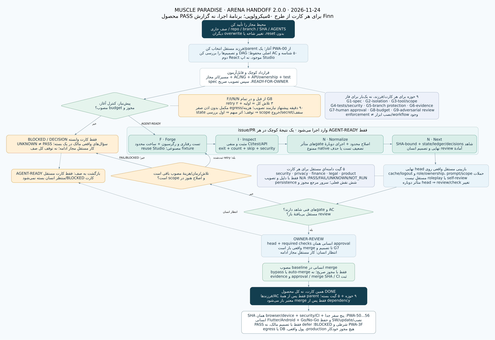
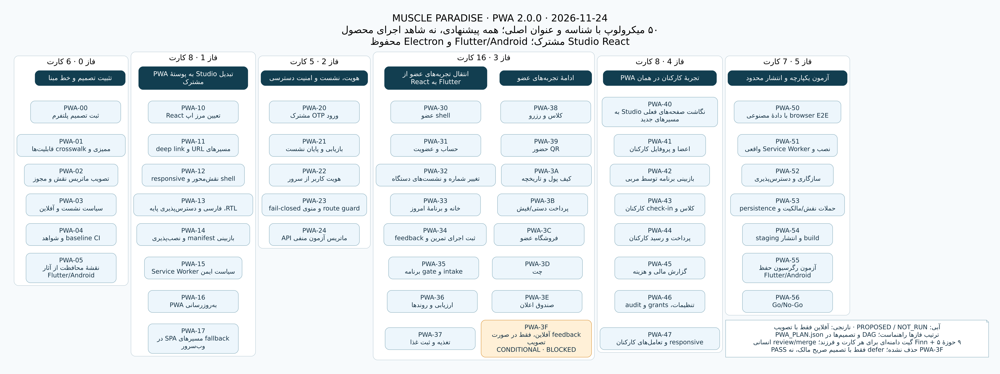

# فلوچارت اصلاح‌شدهٔ PWA و Finn — handoff v2.0.0

**مرجع فعلی:** طرح ارسالی کاربر، دقیقاً **۵۰ parent** در شش فاز با شمارش ۶/۸/۵/۱۶/۸/۷؛ شناسه‌ها غیرپیوسته‌اند و PWA-3A…3F دارند. PWA-56 شمارهٔ آخر است، نه count. هیچ ID/عنوان/مرز پذیرشی حذف، ادغام یا renumber نشده است.

**وضعیت:** برنامهٔ اجرا، نه QA محصول یا تصویب release. `mp-app/studio/` موجود به یک React PWA عضو/کادر توسعه می‌یابد؛ اپ React دوم ساخته نمی‌شود. Flutter/Android، مستندات/تست/CI/Flutter Web و Electron محفوظ‌اند. تصمیم UI مجوز role/DB/payment/offline/release/egress نیست.

## چرخهٔ هر کارت و فرزند

[SVG](PWA_Finn_Loop_Flow.fa.svg) · [DOT منبع تصویر](PWA_Finn_Loop_Flow.fa.dot) · [Mermaid هم‌معنا](PWA_Finn_Loop_Flow.fa.mmd)

Forge → Inspect → Normalize → Next؛ قرارداد AC/NG مصوب و ۹ حوزهٔ Finn، پنج gate مستقل security/privacy/finance/legal/product، budget پیش از شروع، evidence همان SHA، reviewer مستقل واقعی و approval/merge انسانی برای **هر کارت و فرزند** لازم‌اند. G7 تا تصمیم/merge واقعی باز است. فقط کار وابسته BLOCKED می‌شود و مستقلِ مجاز ادامه می‌یابد؛ self-review مستقل، workflow موجود یا نصب ابزار، evidence/enforcement نیست.

۳ تلاش کل = اولیه + ۲ retry. ۹۰ دقیقه پیشنهاد نیازمند تصویب مالک است، نه budget قطعی قدیمی. در سقف، secret یا خروج scope توقف؛ UNKNOWN/NOT_RUN/defer ≠ PASS. هیچ auto-merge، تضعیف تست، حذف native یا deploy/پول واقعی خودکار وجود ندارد.

## نقشهٔ کامل هر ۵۰ شناسه

[SVG](PWA_50_Microloops.fa.svg) · [DOT](PWA_50_Microloops.fa.dot) · [Mermaid](PWA_50_Microloops.fa.mmd)

آبی: PROPOSED/NOT_RUN. نارنجی: PWA-3F شرطی و پیش‌فرض BLOCKED؛ defer فقط با تصمیم صریح مالک و ثبت scope، نه PASS. فاز ۳ در دو ستون ادامه یافته؛ ترتیب بصری جای DAG پیشنهادی و D blockers را نمی‌گیرد.

## بستهٔ مستقل و منابع

- [شروع و دانلود ZIP v2](../handoff/README.md)
- [راهنمای اصلی](../handoff/pwa-arena-v2/HANDOFF.fa.md) / [HTML آفلاین](../handoff/pwa-arena-v2/HANDOFF.fa.html)
- [۵۰ عنوان و AC کامل](../handoff/pwa-arena-v2/MICROLOOPS.fa.md) / [جدول اصلی ارسالی](../handoff/pwa-arena-v2/SOURCE_PLAN.fa.md)
- [Finn نهایی](../handoff/pwa-arena-v2/FINN_LOOP_FINAL.fa.md) / [مقایسه و اصلاح تمام artifactها](../handoff/pwa-arena-v2/COMPARISON_AND_CHANGELOG.fa.md)
- [مرجع منبع MP/c46e792 و snapshotها](../handoff/pwa-arena-v2/references/README.fa.md)

PNG/SVG این نسخه از DOT با Viz/Sharp هم‌خانوادهٔ ابزار مستندسازی موجود MP ساخته شده‌اند؛ نه dependency محصول و نه رندر Mermaid. Mermaidهای کنارشان متن قابل‌ویرایشِ هم‌معنا هستند. نسخهٔ قدیمی داخل [v1 تاریخی](../handoff/pwa-arena-v1/diagrams/PWA_Finn_Loop_Flow.fa.md) و ZIP قبلی دست‌نخورده است؛ ادعای ۲۸ مورد آن نگاشت معتبرِ طرح ارسالی نیست.
