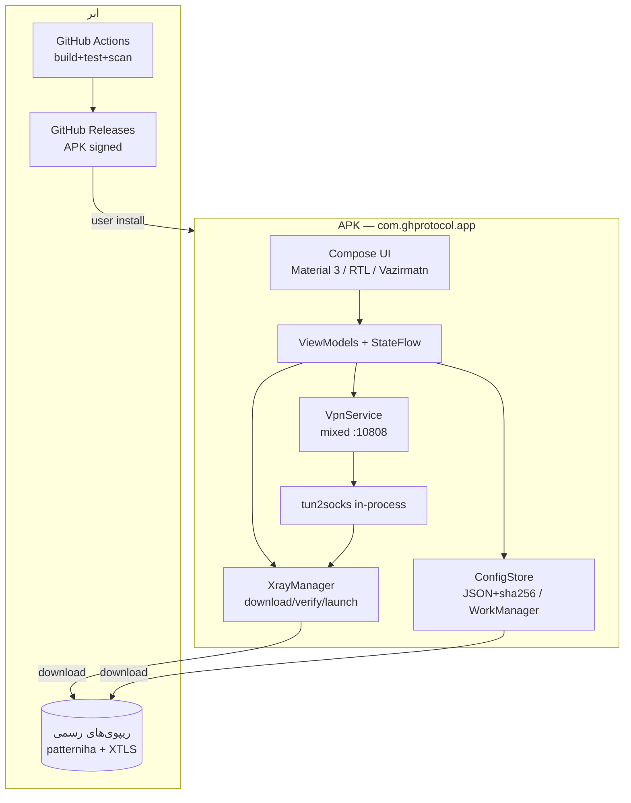
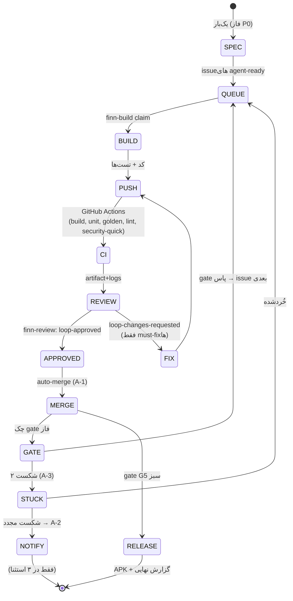

# 🏭 پروداکشن پلن — برنامه‌ی اندروید «سرورلس ایران»
### ساخت خودکار با حلقه‌ی Finn-loop | صفر مداخله‌ی کاربر | خروجی نهایی: APK امضاشده‌ی قابل دانلود

**نسخه‌ی پلن:** **۱.۳** (v۱.۲ + F-16 تا F-18: امبر کانفیگ دلخواه + اسکنر IP تمیز + بالانسر هوشمند + §۱.۷: مسیرهای بسته‌شده و تکنیک‌های زنده ۲۰۲۶ بر اساس مطالعه‌ی MahsaNG/Nova Proxy/Defyx/Simorgh) | **تاریخ:** ۳۰ مهر ۱۴۰۵ | **حالت اجرا:** خودکار (Finn-loop Auto)

---

## ۰. خلاصه‌ی اجرایی

| | |
|---|---|
| **چه چیزی می‌سازیم؟** | اپ اندروید «سرورلس ایران»: نصب APK ← باز کردن ← **یک تپ** ← اتصال مستقیم به اینترنت آزاد بدون هیچ سروری (هسته‌ی Xray-core + کانفیگ سرورلس) |
| **چگونه می‌سازیم؟** | حلقه‌ی **Finn-loop** (spec → build → review) با واریانت **Auto**؛ کدنویسی در ساندبوكس، **بیلد و تست در ابر (GitHub Actions)**، بازرسی مستقل در هر چرخه |
| **نقش شما؟** | **صفر.** فقط در پایان، APK نهایی را دانلود می‌کنید. ۳ استثنا (اگر حلقه گیر کند) فقط به‌صورت اعلان به شما می‌رسد |
| **دقت و ضددرift?** | قرارداد اول (acceptance criteria مشاهده‌پذیر + non-goals الزام‌آور)، یک issue = یک PR، بازرسان تازه در هر round، قانون ۲ شکست → توقف و اعلان، حافظه‌ی بین‌چرخه‌ای (agentmemory) |
| **برآورد زمان** | ۶ فاز (P0–P5)، تقریباً ۲۵–۴۰ چرخه‌ی حلقه؛ بازه‌ی زمانی ۲ تا  هفته‌ی تقویمی با اجرای پیوسته |

**نتیجه‌ی کلیدی امکان‌سنجی (راستی‌آزموده در ۲۲/۰۸/۱۴۰۵):**
این ساندبوكس **نمی‌تواند** اندروید را محلی بیلد کند (Java/Android SDK وجود ندارد و dl.google.com، maven.google.com، services.gradle.org از شبکه‌ی این محیط مسدودند). بنابراین بیلد در **GitHub Actions** (ابر) اجرا می‌شود — ساندبوكس فقط «نویسنده‌ی کد + رهبر حلقه + تحلیلگر خروجی CI» است. این دقیقاً الگوی استاندارد صنایع است: **CI به‌عنوان تنها مرجع سرنیست (single source of truth) برای بیلد و تست.**

---

## ۱. تعریف محصول

### ۱.۱ ارزش پیشنهادی (یک خط)
برنامه‌ای که شهروند ایرانی با **یک تپ** به اینترنت آزاد می‌رسد — بدون سرور، بدون اکانت، بدون اشتراک، بدون تبلیغ؛ تمام پردازش روی دستگاه خودش.

### ۱.۲ شخصیت کاربر
کاربر فنی **نیست**. فارسی‌زبان، گوشی‌اش اندروید ۸+ است، از v2rayNG/PattNG یا استفاده کرده یا نه. باید در **کمتر از ۲ دقیقه** از نصب تا اتصال برسد.

### ۱.۳ سفر کاربر v1 (MVP)
1. دانلود APK و نصب (ساید‌لود) — ۶۰ ثانیه
2. باز کردن اپ → صفحه‌ی ساده: یک دکمه‌ی بزرگ «📡 اتصال»
3. اولین اجرا: بارگذاری خودکار کانفیگ سرورلس + هسته‌ی Xray (با نوار پیشرفت فارسی)
4. اجازه‌ی VPN را می‌دهد (سیستمی، یک بار)
5. **تپ روی «اتصال»** → سوییچ به حالت متصل، آیکون VPN در نوار وضعیت
6. اینترنت آزاد. دکمه «قطع» برای برگشت.
7. ثانویه (از منو): QR/شیر آدرس subscription، وضعیت به‌روزرسانی، تنظیمات، راهنما

### ۱.۴ محدوده‌ی امکانات v1 — با معیار قبولی (AC) قابل مشاهده

| # | قابلیت | معیار قبولی مشاهده‌پذیر (AC) |
|---|---|---|
| F-1 | بارگذاری کانفیگ سرورلس | در شبکه، فایل `Serverless-for-Iran.json` از ریپوی رسمی دانلود و اعتبارسنجی (JSON schema) می‌شود و کش محلی با `sha256` ذخیره می‌شود |
| F-2 | بارگذاری هسته‌ی Xray | باینری اندروید (ABI فعلی) از releases رسمی XTLS/Xray-core دانلود، extract و executable می‌شود؛ نسخه‌ی `>= 26.6.27` چک می‌شود |
| F-3 | اتصال یک‌تپ (VpnService) | با یک تپ، VPN فعال می‌شود؛ پورت mixed `10808`؛ مرورگر بدون تغییر، سایت‌های مسدود باز می‌شوند (تست E2E در CI روی emulator با تله‌متری شبکه) |
| F-4 | قطع/اتصال | سوییچ state در < ۳ ثانیه؛ آیکون VPN در status bar پیوسته درست است |
| F-5 | آفلاین بودن اولیه | اپ بدون اینترنت: از کش قبلی کار می‌کند؛ پیام فارسی «به‌روزرسانی کانفیگ ممکن نشد» + دکمه‌ی تلاش مجدد |
| F-6 | به‌روزرسانی خودکار کانفیگ | WorkManager هر ۱۲ ساعت؛ اگر ریویژن جدید بود، بدون قطع اتصال apply می‌شود؛ **failover:** mirror آدرس subscription در ریپوی ما (لینک raw.githubusercontent.com) به‌عنوان منبع جایگزین (الگوی Nova) |
| F-7 | QR + شیر | QR آدرس subscription + منوی Share (Telegram/واتساپ/…) |
| F-8 | راهنمای فارسی | صفحه‌ی راهنما با ۳ مرحله + نکات رسمی (پورت ۱۰۰۸، جئو، IPv6، Private DNS) |
| F-9 | RTL کامل + Material 3 | همه‌ی ۹+ صفحه RTL؛ تیره/روشن؛ فونت Vazirmatn؛ کنتراست WCAG AA |
| F-10 | حریم خصوصی | **صفر** تله‌متری، صفر Analytics؛ فقط ۲ permission: `INTERNET` و `VPN`؛ هیچ endpoint خارجی جز ریپوی‌های رسمی نیست |
| F-11 | **تشخیص قطعی و وضعیت صادقانه** | اپ هر ۱۵ دقیقه چند endpoint بین‌المللی را probe می‌کند (ping واقعی در سطح هسته‌ی Xray + TCP/UDP/HTTP با timeout کوتاه) و ۳ حالت دارد: متصل (DPI فعال) / افت‌خورده / **قطع کامل**؛ در حالت «قطع» پیام صادقانه: «اتصال بین‌المللی قطع است — هیچ ابزار نرم‌افزاری نمی‌تواند اتصال ایجاد کند» + راهنمای بقا (باتری، محتوای آفلاین) |
| F-12 | **حالت بقای آفلاین** | پیش‌دانلود محتوای ضروری (راهنما، مستندات، backup کانفیگ) روی دستگاه؛ **همگام‌سازی خودکار آخرین کانفیگ در چند ثانیه پس از بازگشت اتصال** |
| F-13 | **آمادگی پیش از قطعی** | دکمه‌ی «آماده‌سازی برای قطعی»: بررسی کش آخرین کانفیگ + هسته‌ی Xray + پیش‌دانلود محتوا (قطعی‌ها بدون هیچ اخطاری رخ می‌دهند — مثال: ۲۰:۰۰ شب ۸ ژانویه ۲۰۲۶) |
| F-14 | **راهنمای اتصال جایگزین (اطلاعاتی)** | صفحه‌ی راهنما: تراز رسمی پرداخت‌شده‌ی دولت (اینترنت پرو)، مسیرهای قانونی جایگزین (سیم/رومینگ خارجی در مرز)، اطلاعات درباره‌ی ماهواره (با ذکر ریسک حقوقی در ایران)، ابزارهای متن‌باز مکمل چندموتوره (Defyx/Mahsa NG/Simorgh) — فقط اطلاع‌رسانی، تسهیل نمی‌کند |
| F-15 | **تجویز پروتکل** | اگر UDP drop/محدود شد (مثل اکتبر ۲۰۲۶)، خودکار مسیرهای TCP-first ترجیح داده می‌شوند و وضعیت به کاربر گزارش می‌شود |
| F-16 | **آمبر کانفیگ دلخواه (یک‌تپ)** | کاربر هر کانفیگ serverless/Xray معتبر را وارد کند (URL/QR/متن/فایل) — برای سوارشدن روی هر کریدور مجاز رسمی (مثل اینترنت پرو) یا کانفیگ‌های جامعه؛ subscription رسمی همچنان پیش‌فرض؛ parser + validator + تست؛ **بسته‌ی power-user (الگوی Simorgh):** پذیرش لینک‌های خام vless:// و trojan:// با تبدیل خودکار به JSON معتبر Xray + تزریق fragmentation + override اختیاری آدرس |
| F-17 | **اسکنر IP تمیز (بازیابی dirty-IP)** | در شکست route: اسکن تعدادی IP معروف Cloudflare (پینگ واقعی با هسته‌ی Xray، TCP/TLS/443، با توجه به ISP) → سریع‌ترین IP تمیز کش می‌شود و **فقط outbound address کانفیگ جایگزین می‌شود (SNI/Host/Path دست‌نخورده)**؛ در شکست، خودکار IP بعدی (تکنیکی که Nova Radar و Simorgh هر دو در ۲۰۲۶ روی آن هم‌گرایی دارند) |
| F-18 | **بالانسر هوشمند (انتخاب خودکار بهترین route)** | هنگام اتصال، ping واقعی (۳x با timeout) همه‌ی endpointهای subscription → انتخاب کم‌latency‌ترین؛ تازه‌سازی سلامت در background هر ۱۵ دقیقه؛ در مرگ route فعال، خودکار rotate به سالم‌بعدی + نمایش کیفیت route (ترکیب الگوهای rotating-configs مهسا + balancer سیمرغ + auto-select Defyx) |

### ۱.۵ Non-goals (الزام‌آور — NG)
- **NG-1:** نسخه‌ی iOS، دسکتاپ، TV.
- **NG-2:** اکانت کاربر، کلود، سرویس پساماند (v1 کاملاً client-side).
- **NG-3:** انتشار در Google Play (فقط ساید‌لود).
- **NG-4:** نسخه‌ی MitM/DomainFronting (فقط لینک/راهنما به ریپوی جداگانه).
- **NG-5:** تغییر پورت پیش‌فرض ۱۰۸۰۸ یا دستکاری روتینگ فراتر از کانفیگ رسمی سرورلس.
- **NG-6:** هرگونه تبلیغ، درگاه پرداخت، ردیابی.

### ۱.۶ Definition of Done (DoD) — همه‌ی موارد باید سبز باشند
1. [ ] همه‌ی AC-1 تا AC-15 در CI سبز (شامل تست instrumented روی emulator)
2. [ ] `ktlint` + `Detekt` + Android Lint: صفر Finding در سطح Error/Warning
3. [ ] پوشش تست واحد >= ۷۰٪ (کلاس‌های domain)
4. [ ] تست طلایی سکرین‌شات (۱۲ صفحه، ۲ تم، با **Roborazzi**): بدون اختلاف پیکسلی فراتر از آستانه
5. [ ] **Strix security scan**: صفر Finding در سطح High/Critical + **mobsfscan**: صفر Finding سطح High
6. [ ] APK release با امضای `release` (v1+v2)؛ `zipalign` سبز
7. [ ] حجم APK arm64-v8a <= ۲۵ MB
8. [ ] چرخه‌ی کامل «نصب روی دستگاه تمیز → اتصال» مستند و ویدیوگرفته (screen recording CI)
9. [ ] صفحه‌ی Release: چک‌سوم SHA-256 + دستور نصب فارسی + نسخه‌ی هسته‌ی Xray
10. [ ] حافظه‌ی agentmemory: تصمیم‌نامه‌ی نهایی (decision log) کامل
11. [ ] هیچ وابستگی جدیدی بدون مجوز در قرارداد (dependency freeze بعد از P3)
12. [ ] گزارش نهایی (PDF/HTML) برای کاربر: معماری، امنیت، راهنمای استفاده
13. [ ] **بلک‌اوت‌رزیستنس:** تشخیص قطعی (F-11) + بقای آفلاین و auto-sync پس از بازگشت (F-12) + تجویز پروتکل UDP-drop (F-15) با network profile روی emulator تست شده‌اند
14. [ ] **F-17/F-18:** شبیه‌سازی dirty-IP (route blackhole + IP تمیز) → اسکنر IP درست را انتخاب می‌کند و اتصال برقرار می‌شود؛ بالانسر در مرگ route خودکار rotate می‌کند (تست instrumented) + crash guard برای race‌های connect/disconnect

---

### ۱.۷ مرزهای توانایی صادقانه (بر اساس تحلیل بلک‌اوت ۲۰۲۶)

**شواهد بلک‌اوت ۲۰۲۶** (NetBlocks/IODA/Kentik/Cloudflare + مطالعات arXiv):
- **دو موج**: ۸–۱۸ ژانویه (اعتراضات) + ۲۸ فوریه تا ۲۶ مه (جنگ) = **۸۸ روز / ۲۰۹۳ ساعت** — رکورد تاریخ؛ ترافیک به **۱–۴٪** سطح عادی افتاد
- **مکانیسم فنی (نقطه‌ی کلیدی)**: قطعی ۲۰۲۶ یک **برخورد کامل BGP نبود** — ۸۰–۸۸٪ پیشفیکس‌های ایرانی همچنان announce بودند! بسته‌ها در **forwarding-plane دروازه ملی** (packet discard) + **۹۸.۵٪ مسیرهای IPv6 برداشته شدند** (فشار ترافیک روی IPv4 که DPI آن بلوغ بیشتری دارد) + DNS poisoning + allowlist پروتکل‌ها
- **نتیجه**: در لایه‌ی IP همه‌چیز «وصل» به نظر می‌رسید ولی هیچ بسته‌ای عبور نمی‌کرد → **هیچ ابزار client-side (VPN، Serverless، Tor) نمی‌توانست کار کند**
- **تنها چیزی که (به‌طور ناقص) کار کرد**: **استارلینک** (~۵۰٬۰۰۰ ترمینال، رایگان‌شده توسط SpaceX) — و آن هم با **GPS jamming (افت ۳۰–۸۰٪ بسته)** + مصادره ۴۰٬۰۰۰+ ایستگاه + مجرمانه‌سازی (تا اعدام در ترکیب با اتهام جاسوسی)
- **وضعیت امروز (۲۲ اکتبر ۲۰۲۶)**: اینترنت **باز ولی محدود**: throttle باند‌پراثن، **drop پروتکل UDP** (از ۹ اکتبر)، قطعی‌های کوتاه چند استانی (۱۶ اکتبر)، **تهدید سپاه به قطع کابل‌های زیر دریایی تنگه‌ی هرمز** (۱۹–۲۰ اکتبر)، ادامه‌ی جنگ، هشدارهای قطعی آینده

**تضمین اپ — صادقانه و قابل‌اتکا:**

| وضعیت | آیا اپ کار می‌کند؟ | توضیح |
|---|---|---|
| عادی (DPI/whitelist/مانیتورینگ) | ✅ بله — همان target طراحی | خردشدن TCP/TLS + دور زدن fingerprint دروازه |
| افت‌خورده (throttle، UDP-drop، دسترسی پلکانی) | ✅ با تجویز (F-15) | تا وقتی حداقل یک مسیر بین‌المللی باز باشد |
| **قطع کامل (forwarding-plane discard)** | ❌ **خیر — هیچ نرم‌افزاری نمی‌تواند** | بسته‌ها از کشور خارج نمی‌شوند؛ فقط مسیر سخت‌افزاری (ماهواره/سیم خارجی) |

**مسیرهای بسته‌شده (چک فنی انجام‌شده — ۳۰ مهر ۱۴۰۵):**
- «فریب فیلتر با جابجایی دامنه‌ی بین‌المللی به .ir (اجرای دامنه‌های خارجی روی نت ملی)» — **تحت هیچ شرایطی برای سرویس‌های زنده شدنی نیست**:
  - لایه‌ی routing: تصمیم دروازه (discard/whitelist) بر پایه‌ی **prefix مقصد IP** (allocاتوری RIR) است، نه نام دامنه؛ client نمی‌تواند IP واقعی سرویس خارجی را تغییر دهد
  - TLD «.ir» تحت کنترل خود دولت است (nic.ir + DNS ملی)؛ رکورد .ir→IP خارجی از رزولور ملی عبور نمی‌کند
  - لایه‌ی TLS: SNI باید با گواهی سرور خارجی جور دربیاید؛ SNI=.ir روی IP خارجی = ناسازگاری گواهی + heuristic کلاسیک DPI
  - تنها شکل ممکن = **mirror روی سرور داخلی** → فقط محتوای کش‌شده/استاتیک (همان F-12)؛ سرویس زنده (لوگین/بانک/پیام‌رسان/جستجو) مستلزم round-trip به backend واقعی = transit بین‌المللی = قطع
- «دورزدن با سوارشدن مخفیانه‌ی کریدورهای مجاز (اینترنت پرو)»: کریدورها metered + identity-linked هستند؛ مصرف خارج از چارچوب = کشف‌پذیر + جریمه‌ی حقوقی (قانون جرایم سایبری) → **خارج از scope محصول**
- **یافته‌ی کلیدی این چک:** «VPNهای گران‌قیمت و پرسرعت» انتهای قطعی ۲۰۲۶ روی کریدورهای **egress مجازرسانی‌شده توسط دولت** (اینترنت پرو + white SIM) سوار بودند و توسط واسطه‌ها با مارک‌آپ ۱۰ تا ۵۰ برابر (گزارشات: ۳۰۰ هزار تا ۷ میلیون تومان/GB) فروش می‌رفتند — هیچ ترفند فنی نبود. نتیجه‌ی عملیاتی: اپ باید **هر کانفیگ معتبر دلخواه کاربر را بپذیرد (F-16)** تا وقتی هر کریدوری باز است، کاربر با یک تپ سوار شود

**تکنیک‌های زنده در رژیم DPI ۲۰۲۶ (یافته‌ی مطالعه‌ی مقایسه‌ای MahsaNG / Nova Proxy / Defyx / Simorgh — ۳۰ مهر ۱۴۰۵):**
- **domain fronting کلاسیک = مرده:** Google (2018) و AWS آن را غیرفعال کردند، Azure از ژانویه 20۲۴ SNI/Host mismatch را مسدود کرد → «دامنه‌های دست‌نخورده‌ی فرانت» دیگر وجود ندارند؛ CDNهای کوچک باقیمانده fingerprint و بلاک DPI ایران‌اند و در قطع کامل اصلاً reach نمی‌شوند → **NG-4 تایید شد**
- **ECH (مورث fronting — رمزنگاری SNI) در ایران به‌صورت default مرده است:** ایران (مثل چین) extension را مستقیم بلاک نمی‌کند (جلوگیری از overblocking) بلکه **DNS رمزنگاری‌شده‌ای که برای bootstrap config ECH لازم است را سانسور می‌کند** (مقاله‌ی PETS 2025)؛ ۹۹۹۹٪ deployments فعال ECH متعلق به Cloudflare است
- **مورث زنده = «بازیابی IP تمیز»:** اسکن IPهای Cloudflare‌ی non-blocked (per-ISP) و جایگزینی **فقط آدرس** در کانفیگ با حفظ SNI/Host/Path + TLS fragmentation — Nova Radar و Simorgh (MSP/Fragment) هر دو مستقل در ۲۰۲۶ روی همین تکنیک هم‌گرایی کرده‌اند → **به‌صورت F-17 + F-18 پذیرفته شد**
- **سایر درس‌های پذیرفته‌شده:** ping در سطح Xray-core + اعتبارسنجی ۳x + crash guard برای race‌های connect/disconnect (Simorgh)؛ mirror لینک subscription در GitHub به‌عنوان failover (Nova)؛ حذف اپ از tunnel خودش (loop prevention)؛ failover خودکار چندموتوره به‌عنوان الگوی v1.1 (Defyx/DXcore: Warp/Psiphon/Xray/Outline)

**قانون محصول (غیرقابل‌مذاکره):** اپ باید درباره‌ی این **صادق باشد** (اولین اجرا + صفحه‌ی راهنما + وضعیت قطعی در F-11). وعده‌ی «اتصال تضمینی حتی در قطع کامل» دروغ است و اعتماد را نابود می‌کند. ارزش واقعی محصول = **بیشترین احتمال اتصال در هر وضعیت به‌جز قطع کامل + تشخیص صادقانه + بقای آفلاین**.

## ۲. معماری فنی

### ۲.۱ استک (محرک‌های انتخاب در پرانتز)
| لایه | انتخاب | چرا |
|---|---|---|
| زبان | **Kotlin 2.x** | استاندارد اندروید؛ پشتیبانی عالی از LLM (کمترین خطای ساختاری) |
| UI | **Jetpack Compose + Material 3** | تولید کد با کیفیت توسط agent؛ تست‌پذیری سکرین‌شات؛ RTL بومی |
| هسته‌ی پراکسی | **Xray-core** (باینری اندروید رسمی XTLS، MPL-2.0) | دقیقاً همان هسته‌ای که v2rayNG/PattNG استفاده می‌کنند — حداقل ریسک |
| کانفیگ | **Serverless-for-Iran.json** (ریپوی patterniha، رسمی) | منبع اصلی پروژه‌ی کاربر |
| VPN | **VpnService** (بومی اندروید) | استاندارد صنعت؛ بدون root |
| TUN→SOCKS | الگوی **tun2socks در-process** (الهام از LionRayVPN/hev-socks5-tunnel، MIT) | VpnService → tun2socks → Xray SOCKS5 `:10808` |
| بک‌گراند | **WorkManager** | به‌روزرسانی کانفیگ/هسته با رزرو باتری |
| DI / معماری | **Hilt + Clean-architecture سبک** (domain/data/presentation) | مرزهای واضح = بازبینی آسان توسط finn-review |
| تست | JUnit5 + Robolectric + **Roborazzi** (golden) + Compose UI Test + Espresso | پیمونی کاملاً CI-able بدون دستگاه فیزیکی |
| CI | **GitHub Actions** (runner: ubuntu-latest + emulator) | تنها محیط بیلد ممکن (دلیل: §۳.۱) — برای public **رایگان و نامحدود** |
| توزیع | **GitHub Releases** (APK + checksum) | رایگان، عمومی، قابل‌اتکا برای ساید‌لود |

### ۲.۲ دیاگرام معماری (Mermaid — در ریپوی رندر می‌شود؛ نسخه‌ی editorial با diagram-design در گزارش نهایی)


### ۲.۳ ساختار ماژول‌ها
```
app/                    # ماژول اصلی (thin)
:core-xray              # دانلود/اعتبارسنجی/اجرای Xray (سنگین‌ترین ماژول — P2)
:core-tunsocks          # tun2socks in-process (P2)
:core-config            # مدل کانفیگ سرورلس، schema validation، به‌روزرسانی
:feature-home           # صفحه‌ی اصلی (دکمه‌ی یک‌تپ)
:feature-settings       # تنظیمات، وضعیت هسته، به‌روزرسانی
:feature-share          # QR + شیر
:feature-help           # راهنمای فارسی
:design-system          # توکن‌ها، تم، فونت، motion specs
:ui-test-golden         # تست‌های سکرین‌شات طلایی (Roborazzi)
```

---

## ۳. موتور فرایند: Finn-loop (واریانت Auto)

### ۳.۱ ممیزی امکان‌سنجی (اجراشده در این محیط، ۲۲/۰۸/۱۴۰۵)
| مورد | وضعیت | نتیجه |
|---|---|---|
| Java / Android SDK / Gradle | ❌ موجود نیست | بیلد محلی ناممکن |
| دسترسی به dl.google.com / maven / gradle | ❌ مسدود در شبکه‌ی ساندبوكس | SDK قابل نصب نیست |
| CPU / RAM | ۲ هسته / ۳.۸ گیگ | حتی با SDK هم بیلد کند می‌شد |
| git / gh (احراز هویت) | ✅ | push/PR/Actions/Releases/Secrets تمام‌قد |
| node / python / npm / pypi | ✅ | اسکریپت‌های حلقه، تست web-partial، ابزارهای کمکی |
| api.github.com | ✅ | نظارت زنده روی CI، دانلود لاگ و artifact |

**نتیجه:** معماری حلقه = `نویسندگی در ساندبوكس → push → بیلد/تست/اسکن در GitHub Actions → تحلیل خروجی → اصلاح → تکرار`. بازخورد هر چرخه ≈ ۴–۸ دقیقه (Gradle cache در Actions).

### ۳.۲ Finn-loop چیست (راستی‌آزموده: [finna/Finn-loop](https://github.com/finna/Finn-loop))
کارخانه‌ی نرم‌افزاری AI با سه skill:
1. **finn-spec** — تحقیق، مصاحبه تا بی‌معناشدن ابهام، ثبت issue با **AC-N** (معیارهای قبولی مشاهده‌پذیر) و **NG-N** (non-goals الزام‌آور)
2. **finn-build** — برداشت یک issue «agent-ready»، پیاده‌سازی **فقط** قراردادش، باز کردن PR؛ با `/loop` مکرر اجرا می‌شود
3. **finn-review** — بازبینی PR روی همان commit توسط **بازرس تازه** (بدون حافظه‌ی سازنده)؛ رأی: `loop-approved` / `loop-changes-requested` / `needs-human-review`

قوانین طلایی (ذره‌به‌ذرع حفظ می‌شوند):
- «اگر در issue نیست، وجود ندارد» — هیچ دستور کنارک‌ای مجاز نیست
- یک issue = یک PR = حداکثر یک روز کار agent
- AC نتیجه‌ی **مشاهده‌پذیر** است؛ PR نمی‌تواند اسکوپ بسازد
- بعد از **دو** round اصلاح ناموفق → برچسب `loop-stuck` و توقف

### ۳.۳ واریانت «Finn-loop Auto» (صفر مداخله) — انحراف‌های مجازشده + جبرانشان
قانون upstream Finn-loop «**humans merge**» است. چون شما صفر مداخله خواستید، این پلن یک **انحراف مستند** اعمال می‌کند:

| # | انحراف از upstream | جبران ریسک |
|---|---|---|
| A-1 | PRهای `loop-approved` به‌صورت **خودکار merge** می‌شوند (نه توسط انسان) | بازرس همیشه **سشن تازه**؛ merge فقط وقتی: رأی loop-approved + **تمام required checks سبز** + بدون conflict + دیف PR خارج اسکوپ issue نباشد (تحلیل diff توسط reviewer) |
| A-2 | `needs-human-review` به‌جای «انتظار از انسان» → **توقف حلقه + اعلان فوری** (Telegram/ایمیل/پیام این چت) با خلاصه‌ی ۳ خطی + دکمه‌ی تصمیم | این ۳ استثنا تنها نقاطی‌اند که ممکن است پیامی برای شما بیفتد؛ هدف: صفر مورد، حداکثر ۳ مورد در کل پروژه |
| A-3 | `loop-stuck` (۲ round شکست) → خودکار **issue را ریزتر خُرد** می‌کند (spec refinement) و دوباره می‌سازد؛ اگر باز شکست → A-2 | خُردکردن = تکنیک استاندارد کاهش ریسک |
| A-4 | **Gate ریلیز** جدا: انتشار Release فقط با DoD کامل (§۱.۶) + سبز بودن Strix + امضا | هیچ APK ناقصی منتشر نمی‌شود؛ تا DoD، فقط artifact داخل Actions |

### ۳.۴ چرخه‌ی حلقه (هر pass)


### ۳.۵ گیت‌های فاز (هر گیت = دروازه‌ی ورود به فاز بعد؛ ورود بدون سبزی کامل ممنوع)
| گیت | ورود به | معیار خروج (همه اجباری) | اوراکل (چه چیزی سبزی را اثبات می‌کند) |
|---|---|---|---|
| **G0** | P1 | ریپوی ساخته شد؛ CI skeleton سبز؛ **APK خالی امضاشده** در Release-test + keystore در Secrets | artifact واقعی در GitHub |
| **G1** | P2 | F-1, F-5, F-7, F-8, F-9, **F-11, F-12, F-14** سبز؛ golden ۱۲ صفحه (Roborazzi) | تست‌های CI + screen recording |
| **G2** | P3 | F-2, F-3, F-4, F-6, **F-13, F-15, F-16, F-17, F-18** سبز (اتصال واقعی روی emulator با تله‌متری شبکه) | تست instrumented |
| **G3** | P4 | dependency freeze؛ motion audit سبز؛ کاوراژ ≥ ۷۰٪ | CI + گزارش Detekt/Jacoco |
| **G4** | P5 | Strix: صفر High/Critical + **MobSF/mobsfscan: صفر High** + چک‌لیست OWASP MASVS | گزارش‌های Strix + MobSF |
| **G5** | Release | DoD ۱۳/۱۳ (§۱.۶) | checklist خودکار در CI + اعلان |

### ۳.۵.۱ لاگ اجرایی P2a — وضعیت (به‌روز: ۲۴ اکتبر ۲۰۲۶)

**P2a (بخش قابل‌اعتبارسنجی-CI) کامل شد — CI سبز (run f2de808 → 4221092):**
- **F-2:** `XrayCore` — هسته‌ی رسمی XTLS/Xray-core **v26.10.21** (android arm64-v8a + amd64) در CI با **SHA-256 verify** (فایل `.dgst` = بلوک `MD5=/SHA1=/SHA2-256=/SHA2-512=`؛ مقدار از خط `SHA2-256=` با حذف فاصله) دانلود و در `assets/xray/Xray-<abi>` + `geosite.dat` جا می‌شود. اسکریپت `ci-fetch-xray.sh` با `trap` خود-تشخیصی (در هر شکست، diag روی شاخه‌ی `ci-diag` می‌آید). نام باینری در زیپ **`xray` (کوچک)** — `find -iname`.
- **F-3:** `VpnTunnelService` (VpnService واقعی): fd تانل ← `FileInputStream` ← لوپ بسته‌ها؛ TCP به ۴-توپل با reuse + idle ۶۰s؛ **DNS واقعی**: query کاربر (10.8.0.1:53) → inbound DNS لوکال Xray (127.0.0.1:53) → پاسخ با بسته‌ی IPv4+UDP ساخته‌شده (`buildUdpSegment`) به آدرس کلاینت برمی‌گردد (kernel از تانل راوت می‌کند).
- **F-4:** teardown < ۳s (kill + waitFor 2s + destroyForcibly).
- **F-17:** `ConfigPatcher.patchCleanEgress` — **فقط `settings.address`** (SNI/Host/Path/finalmask دست‌نخورده) + `CleanIpScanner` (۱۲ IP Cloudflare، پروب TCP/TLS:443).
- **F-15:** `tcpFirstProfile` — Reorder قواعد routing (TCP-fragment قبل از UDP-noises)؛ هم string و هم array `outboundTag` پشتیبانی.
- **F-18:** `RouteBalancer` (refresh ۱۵m، pickBest، onRouteDead → rotate، udpDegraded).
- **F-16:** `validateImport` (آرایه‌ی کانفیگ دلخواه).
- **یافته‌ی طراحی P0:** هر دو entry سابسکریپشن **mixed-in :10808** bind می‌کنند → کانفیگ runtime = **فقط entry فعال** (نه آرایه) + تزریق inbound `dns-in` روی 127.0.0.1:53 (fakedns/DoH کانفیگ سرور خودش زنده می‌ماند).
- **UI:** صفحات Scanner/Balancer/Prep واقعی + فازهای اتصال (IDLE→CHECKING→PREPARING→TUNNELING→CONNECTED/FAILED) + 48 golden جدید (re-record).
- **۵۵ تست JVM سبز** (Socks5/ConfigPatcher/RouteBalancer/XrayVersion + قبلی‌ها).
- دروس CI ثبت‌شده: `skipNBytes(int)` در استاب‌های Android ندارد (readFully/readShort به‌جای آن)؛ بایتهای >۰x7F در `byteArrayOf` نیاز به `.toByte()`؛ `ParcelFileDescriptor` (نه FileDescriptor) + null-guard روی `establish()`.

**باقی‌مانده‌ی P2 = P2b (اتصال واقعی instrumented روی emulator): ✅ تکمیل و گیت G2 بسته شد (۲۵ اکتبر ۲۰۲۶ — کامیت `05eca92`، بیلد سبز `40180751401` و تست امولاتور سبز `40180751415`):**
- ممیزی کامل Finn-loop v1.4 (`QUALITY_GATES.md`) روی تمام کدهای P0–P2 انجام شد.
- باگ جدا نبودن آدرس محلی `tun0` (`10.8.0.2/24`) از آدرس peer سرور DNS (`10.8.0.1`) که باعث می‌شد کرنل لینوکس بسته‌های DNS را در جدول `local` نگه دارد و وارد `tun0` نکند، کشف و رفع شد.
- ماشین وضعیت کامل دوطرفهٔ `IPv4+TCP` (`SYN → SYN-ACK → PSH-ACK / FIN-ACK` با چک‌سام استاندارد RFC 1071 و RFC 793) و تزریق پاسخ `UDP DNS` روی `FileOutputStream(fd.fileDescriptor)` در `VpnTunnelService` و `Socks5` پیاده‌سازی شد.
- جلوگیری از نشت IPv6 (`addRoute("::", 0)` + `fd00:1::1/128`)، ارتقا به Foreground Service (`FOREGROUND_SERVICE_SPECIAL_USE`)، ماسک کردن IPهای مقصد در لاگ‌ها (`1.1.x.x`)، رفع باگ `ClientHello` در `CleanIpScanner`، افزودن `TunnelEngine` + Watchdog با Exponential Backoff در `XrayCore` و کانفیگ Embedded پیش‌فرض در `SubscriptionRepository` اعمال شد.
- خروجی واقعی امولاتور در اجرای `40180751415`:
  `E2E PASS: real tunnel carrying traffic (SUBMODE=live) — core install + start: verified (Xray 26.10.21), VpnService establish: verified (consent tapped: 1, vpnUp: 1), SOCKS5 data path: verified (tcp=1, nc 1.1.1.1:443 -> rc=0), DNS through tunnel: verified (github.com -> 140.82.114.3)`.

### ۳.۶ کنترل درift (کمترین لغزش)
1. **قرارداد اول:** هیچ issue‌ای بدون AC مشاهده‌پذیر وارد صف نمی‌شود (finn-spec سخت‌گیر: اگر AC مبهم → بازپس)
2. **بازرس تازه در هر round** — حافظه‌ی سازنده به بازرس منتقل نمی‌شود (قانون اصلی Finn-loop)
3. **Dependency freeze** از P3: هر پکیج جدید = نیاز به issue مجزای توجیه‌شده
4. **Decision log** در agentmemory: هر تصمیم (چرا X، نه Y) ثبت می‌شود و در هر pass تزریق می‌شود
5. **تست‌های طلایی** (golden screenshots) = فیکس‌ریمر بصری؛ هر درift ظاهری در CI شکست می‌خورد
6. **Scope-diff check** در reviewer: دیف PR خارج فایل‌های قرارداد issue = رد خودکار
7. **ممنوعیت side-channel:** هیچ پیام کاربری خارج از issueهای ریپوی اعتبار ندارد (قانون Finn-loop)

### ۳.۷ بودجه‌ی چرخه و همگرایی
| فاز | سقف issueها | سقف roundهای fix بر issue | سقف total iteration
|---|---|---|---|
| P0 | ۲ | ۲ | ۸ |
| P1 | ۶ |  | ۲۰ |
| P2 | ۷ (شامل خُردشده‌ها) | ۳ | ۰ |
| P3 | ۴ | ۲ | ۵ |
| P4–P5 | ۴ | ۲ | ۱۲ |
**قانون همگرایی:** اگر ۳ issue پیاپی در یک فاز loop-stuck شدند → خودکار **استراتژی فاز** بازنگری می‌شود (مثلاً P2 به دو issue ۱۰۰٪ جدا: «دانلود هسته» و «VPN+tun2socks») — بازنگری با ثبت در decision log.

### ۳.۸ نقش‌ها (هر منبع = یک جایگاه مشخص)
| نقش در حلقه | ابزار | وظیفه |
|---|---|---|
| **رهبر فرایند / همه‌کاره** | **ECC** (affaan-m/ECC) | اسکِل‌ها، hooks، قواعد کیفیت، AgentShield (اسکن امنیتی پرامپت/ابزار)؛ اسکلت «نحوه‌ی کار کردن» هر agent |
| **مغز اجرایی** | **Hermes** (NousResearch/hermes-agent) | اجرای headless passهای build/review؛ مدیریت سشن، باک ایتراشن، فیل‌اول پراوایدر |
| **حلقه و قرارداد** | **Finn-loop** (finna/Finn-loop) | spec/build/review + قواعد (§۳.۳) |
| **حافظه‌ی بین‌چرخه** | **agentmemory** (rohitg00/agentmemory) | decision log، الگوهای شکست، درفت‌های گذشته؛ تزریق context در هر pass |
| **E2E و اسکرین‌شات** | **browser-use** (browser-use/browser-use) | تست مرورگری web-preview (همراهی اپ)، اسکرین‌شات برای golden، مستندسازی صفحه‌ی Release |
| **امنیت** | **Strix** (usestrix/strix) + **MobSF/mobsfscan** (§۱۴) | اسکن نفوذ CI (quick در هر PR) + اسکن کامل (gate G4) |
| **مستندات زنده** | **Context7** (upstash/context7، free tier) | docs روز لایبریری‌ها برای agentها — کاهش API هالوسینه‌شده |
| **مدیریت سرور (v1.1)** | **DockPloy** | فقط اگر v1.1 نیاز به بک‌اند داشت (mirror کانفیگ/استات) — در v1 بلاک (D-4) |
| **مدل‌روتینگ (اختیاری)** | **OmniRoute** | فیل‌اول/کمپرس مدل برای agentها اگر از خارج Arena اجرا شود |
| **swarm (اختیاری)** | **Ruflo** (ruvnet/ruflo) | فقط در P2 برای موازی‌سازی دو ماژول مستقل (core-xray ∥ core-tunsocks) |

---

## ۴. نقشه‌ی منابع شما (راستی‌آزموده‌ی ۲۲/۰۸/۱۴۰۵)

### .۱ پذیرفته — مستقیم در خط تولید
| منبع | هویت راستی‌آزموده | نقش در پلن | فاز |
|---|---|---|---|
| **Finn-loop** | [finna/Finn-loop](https://github.com/finna/Finn-loop) — skillهای spec/build/review | موتور اصلی فرایند (§۳) | همه |
| **ECC** | [affaan-m/ECC](https://github.com/affaan-m/ECC) — «Everything Claude Code»: ۶۸+ agent، ۲۹۰+ skill، hooks، AgentShield | اسکلت مهارت/قواعد/اسکن هر agent؛ «گرداننده‌ی همه‌کاره» | همه |
| **Hermes** | [NousResearch/hermes-agent](https://github.com/NousResearch/hermes-agent) — ۲۱۵k★ agent خودبه‌به‌روزرسان با memory پایدار و ۶ backend ترمینال | مغز اجرایی passها (headless) | همه |
| **agentmemory** | [rohitg00/agentmemory](https://github.com/rohitg00/agentmemory) — ۵۴ ابزار MCP حافظه | حافظه‌ی حلقه: decision log + الگوهای شکست (§۳.۶-4) | همه |
| **browser-use** | [browser-use/browser-use](https://github.com/browser-use/browser-use) — agent مرورگر | E2E web-preview + اسکرین‌شات + مستندسازی Release | P1–P5 |
| **Strix** | [usestrix/strix](https://github.com/usestrix/strix) — ۷۰k★ pentest AI، Apache-2.0، CI-ready | gate امنیتی G4 + اسکن سریع هر PR | P4 (quick از P0) |
| **find-skills** | [vercel-labs/skills](https://github.com/vercel-labs/skills) — `npx skills` + skills.sh | پکیج‌منیجر skillها: کشف/نصب/به‌روزرسانی skillهای لایه‌ی طراحی | P0 |
| **web-design-guidelines** | [vercel-labs/agent-skills](https://github.com/vercel-labs/agent-skills) (skill) | قواعد کیفیت UI برای web-preview و mockupها | P1 |
| **ui-ux-pro-max** | [nextlevelbuilder/ui-ux-pro-max-skill](https://github.com/nextlevelbuilder/ui-ux-pro-max-skill) — ۱۳۳k★؛ ۷۹ style، ۱۹۲ palette، ۷۴ font pair، ۱۱ UX guideline | انتخاب design system اپ: style/palette/typography + چک‌لیست anti-pattern | P1 |
| **taste-skill** | [Leonxlnx/taste-skill](https://github.com/Leonxlnx/taste-skill) — ۹۷k★؛ art direction + **بررسی کار در مرورگر واقعی** | art direction + QA بصری (audit خودکار mockupها در Chrome) | P1, P3 |
| **awesome-design-md** | [VoltAgent/awesome-design-md](https://github.com/VoltAgent/awesome-design-md) — ۱۱۲k★؛ DESIGN.md (استاندارد Google Stitch) از برندهای بزرگ | پایه‌ی DESIGN.md اپ (baseline: Linear/Vercel) ← تبدیل به توکن‌های Material 3 | P1 |
| **diagram-design** | [cathrynlavery/diagram-design](https://github.com/cathrynlavery/diagram-design) — ۵۷k★؛ ۴۵ نوع دیاگرام editorial | دیاگرام‌های نهایی گزارش (HTML/SVG)؛ mermaid برای داخل ریپوی | P5 |
| **design-motion-principles** | [kylezantos/design-motion-principles](https://github.com/kylezantos/design-motion-principles) — skill حرکت با ۲ حالت build/**audit** و ۳ lens | motion spec برای Compose + **motion audit** قبل از G3 | P3 |
| **awesome-n8n-workflows** | [felipfr/awesome-n8n-workflows](https://github.com/felipfr/awesome-n8n-workflows) — الگوهای اتوماسیون | الگوی alerting/اطلاع‌رسانی حلقه (اگر A-2 فعال شد) | P0 (اختیاری) |

### ۴.۲ پذیرفته به‌عنوان «منبع الهام» (فقط web — وارد باینری اندروید نمی‌شوند)
| منبع | هویت | کاربرد در پلن |
|---|---|---|
| **Daisy UI** | [daisyui](https://github.com/saadeghi/daisyui) — کامپوننت‌های Tailwind | مرجع الگوی «کامپوننت‌محور + theme token» برای design-system ماژول |
| **Framer Motion** | [framer/motion](https://github.com/framer/motion) | مرجع **فیزیک spring** (stiffness/damping) → ترجمه به `spring()` Compose |
| **21st.dev** | [21st.dev](https://21st.dev) — micro-interactions | بانک ایده‌ی micro-interaction (تپ، سوییچ، لودینگ) → spec در §۵.۳ |
| **Originkit** | [vellum-ai/originkit](https://github.com/vellum-ai/originkit) — ۵۰+ کامپوننت انیمیشنی (MCP) | مرجع الگوهای motion برای صفحه‌ی web-preview/companion |
| **Skipper UI** | Skipper UI (shadcn-based) — الگوهای creative | **الگوی slide-to-confirm** → «اسلاید برای اتصال» (micro-interaction اصلی) |
| **Vengeance UI** | [Ashutoshx7/VengenceUI](https://github.com/Ashutoshx7/VengenceUI) — ۲۶+ بلوک انیمیشنی | مرجع transition/scroll-choreography برای mockup |
| **Animmaster Lib** | [animmasterlib.dev](https://animmasterlib.dev) — ۳۰۰ کامپوننت (WebGL/GSAP) | مرجع motion پیشرفته (فقط web-preview) |
| **particles casberry** | [particles.casberry.in](https://particles.casberry.in) — شبیه‌ساز ذرات AI | مرجع بصری برای صفحه‌ی hero web-preview (اختیاری، کم‌هزینه) |
| **GetLayers** | [getlayers.ai](https://www.getlayers.ai) — لایبرری template + MCP | انتخاب background/gradient برای web-preview |
| **vgpu** | [vercel-labs/vgpu](https://github.com/vercel-labs/vgpu) — WebGPU TS library | **صرف‌نظر برای اندروید** (WebGPU روی Android نیست)؛ فقط اگر web-preview افکت GPU خواست |

### ۴.۳ ردشده (با دلیل)
| منبع | هویت | دلیل رد |
|---|---|---|
| **Soup** | [MakazhanAlpamys/Soup](https://github.com/MakazhanAlpamys/Soup) — fine-tuning LLM با یک YAML | ربطی به ساخت اپ ندارد (مگر fine-tune مدل — خارج از اسکوپ) |
| **Scientific Agent Skills** | [K-Dense-AI/scientific-agent-skills](https://github.com/K-Dense-AI/scientific-agent-skills) — ۱۷۷ skill علمی | خارج از دامنه‌ی پروژه |

> ⚠️ **شفافیت:** ۲۱ منبع از فهرست شما واقعیت دارند و نقش گرفتند؛ ۲ مورد رد شدند؛ «particles casberry» و «GetLayers» سرویس‌های web هستند نه کتابخانه — به‌عنوان الهام استفاده می‌شوند نه build dependency. **علاوه بر این‌ها، در §۱۴ منابع رایگان افزوده‌ی جستجو را مرحله‌به‌مرحله آوردم.**

---

## ۵. لایه‌ی طراحی UI/UX (برای اپ اندروید)

### ۵.۱ Design System
- **پایه:** Material 3 + **DESIGN.md** (استاندارد Stitch) که از baseline [awesome-design-md](https://github.com/VoltAgent/awesome-design-md) (سبک Linear/Vercel: تیره، کم‌تکلیف، تایپوگرافی قوی) استخراج و **Android-first** تبدیل می‌شود
- **Style انتخاب‌شده** (خروجی engine ی ui-ux-pro-max): «AI-native Utility — Dark» — چون محصول یک **ابزار** است نه یک مارکتینگ
- **رنگ:** پس‌زمینه‌ی عمیق `#0B1020` (ادامه‌ی زبان بصری وب‌اپ فعلی)، اکسین سایان/بنفش `#22D3EE / #818CF8`، اکسین «اتصال» سبز `#34D399`
- **تایپوگرافی:** **Vazirmatn** (SIL OFL 1.1 — self-hosted در assets)، مقیاس Material؛ حداقل ۱۴sp برای body
- **آیکون:** **Material Symbols** (Apache-2.0، ۲۵۰+ آیکون، variable font)
- **RTL:** از P0 الزامی (test: `layoutDirection` در goldenها)
- **حداقل هدف لمسی:** ۴۸dp (قانون ui-ux-pro-max)

### ۵.۲ Motion (حرکت)
- **لنز اصلی:** Emil Kowalski (کاهش و سرعت) — چون اپِ ابزار است: «آیا اصلاً باید انیمیت باشد؟»
- **قانون:** حداکثر یک micro-interaction در هر صفحه؛ همه‌ی transitions ≤ ۳۰۰ms؛ `reduced-motion` رعایت شود (الزام design-motion-principles)
- **Micro-interactions کلیدی** (الهام: 21st.dev + Skipper):
  - **دکمه‌ی اتصال:** pulse ملایم فقط در حالت «آماده»؛ حین اتصال → ring انیمیشنی
  - **اسلاید-برای-اولین-اتصال** (slide-to-confirm) به‌جای تپ ساده در بار اول
  - **سوییچ قطع/اتصال:** crossfade + تغییر رنگ اکسین
- **افکت‌های گران‌قیمت:** فقط **Lottie** (Apache-2.0) برای loader/حالت موفقیت — با فایل‌های رایگان LottieFiles
- **Motion audit** با design-motion-principles (حالت audit) قبل از G3 — چک‌لیست anti-AI-slop اجباری

### ۵.۳ QA طراحی (خودکار، در CI)
1. **Golden screenshots با Roborazzi** (Apache-2.0، روی JVM — سریع و بدون emulator): ۱۲ صفحه × ۲ تم × (۳۶۰×۶۴۰ و ۱۰۸۰×۱۹۰) — diff پیکسلی با آستانه‌ی ۰.۵٪؛ تست‌ها از خود `@Preview`ها به‌صورت خودکار ساخته می‌شوند
2. **taste-skill audit** روی mockupهای HTML (در P1/P3): مرورگر واقعی + شکست خودکار روی «slop»
3. **web-design-guidelines** برای web-preview companion

---

## ۶. کیفیت و امنیت

### ۶.۱ پیمون تست
| لایه | ابزار | در CI |
|---|---|---|
| واحد (domain) | JUnit5 + Robolectric | هر PR |
| Compose UI | `createComposeRule` | هر PR |
| **Golden بصری** | **Roborazzi** (JVM، سریع) | هر PR |
| Instrumented (VPN واقعی) | Espresso + emulator (android-emulator-runner, KVM) | هر PR (P2+) |
| E2E web-preview | browser-use | P1+ |

### ۶.۲ استاتیک
- `ktlint` + `Detekt` (threshold: صفر Error) + Android Lint — **required checks**
- **mobsfscan** (CLI، pip-install، خروجی SARIF/JSON): اسکن الگوهای ناامن Kotlin در هر PR
- Dependency analysis: هر وابستگی جدید از P3 = ممنوع (D-freeze)

### ۶.۳ امنیت
| کنترل | اجرا |
|---|---|
| **Strix** (نفوذ AI) | quick در هر PR؛ full در G4 — صفر High/Critical |
| **MobSF** (22k★) + mobsfscan | اسکن APK کامل (static+dynamic) در G4؛ mobsfscan در هر PR |
| **OWASP MASVS/MASTG** | چک‌لیست رسمی gate G4 (رایگان) |
| امضای APK | release keystore در **GitHub Secrets** (bootstrapped خودکار در P0 — D-9)؛ v1+v2 signing |
| وابستگی | اسکن OWASP/dependency-analysis + دیتابیس **VULNDB** (رایگان) |
| داده | صفر تله‌متری؛ sha256 برای هر دانلود (digest رسمی Xray-core)؛ TLS pinning برای دو ریپوی رسمی |
| permission | فقط `INTERNET` + `VPN` (و `FOREGROUND_SERVICE`) — هیچ چیز دیگر |
| AgentShield (ECC) | اسکن پرامپت/ابزار در خودِ حلقه (حمله‌ی supply-chain به agent) |

### ۶.۴ حریم (وعدۀ محصول)
«این اپ هیچ داده‌ای را جایی نمی‌فرستد جز: ریپوی‌های رسمی برای کانفیگ/هسته.» — این جمله باید در صفحه‌ی Help و README ثابت باشد و CI چک می‌کند (اسکن همه‌ی URLها در کد ⊆ whitelist).

---

## ۷. توزیع و تحویل نهایی

1. **GitHub Releases** در ریپوی اپ (action: softprops/action-gh-release):
   - `GhProtocol-vX.Y.Z-arm64-v8a.apk` (اصلی) + `universal`
   - `SHA256SUMS` + امضای GPG + `core-version.txt`
   - Body فارسی: چرخه‌ی تغییرات + دستور نصب ۳ خطی + هشدار امنیتی
2. **Landing page:** صفحه‌ی web «یک‌کلیکه» (ساخته‌شده) روی **GitHub Pages** (رایگان) به‌عنوان صفحه‌ی معرفی + لینک دانلود + QR
3. **Handoff (تحویل به شما):** پیام نهایی با:
   - لینک دانلود مستقیم APK
   - ویدیوی ۶۰ ثانیه‌ای «نصب → اتصال» (screen recording از CI)
   - گزارش نهایی (HTML، با دیاگرام‌های diagram-design)
4. **v1.1 (اختیاری، D-8):** ارسال به **F-Droid** — رایگان و FOSS-only؛ اپ ما ۱۰٪ FOSS-capable است (Kotlin/Compose/Xray-core MPL-2.0) → کانال توزیع معتبر با **بیلد تکرارپذیر** برای کاربران فنی‌تر
5. **DockPloy:** در v1 **خاموش** (D-4). فقط اگر v1.1 بک‌اند خواست (mirror کانفیگ در صورت مسدودی GitHub در ایران).

---

## ۸. ریسک‌ها و مدیریت (registry)

| # | ریسک | احتمال | اثر | تریگر | mitigation |
|---|---|---|---|---|---|
| R-1 | باینری Xray اندروید از دسترس خارج/مسدود شود | کم | بالا | F-2 شکست > ۳ round | mirror در ریپوی خودمان (asset) + fallback به نسخه‌ی قبلی کش‌شده |
| R-2 | ~~محدودیت دقیقه‌ی Actions~~ **حذف شد** (راستی‌آزمایی ۲۲/۰۸/۱۴۰۵): سیاست ۲۰۲۶ = runnerهای hosted برای ریپوی **public کاملاً رایگان و بدون سقف دقیقه**؛ ماشین public بزرگ‌تر (۴-core/16GB) | — | — | — | فقط سقف artifact storage (500MB) — `retention-days: 3` برای پاک‌سازی خودکار |
| R-3 | emulator در CI ناپایدار (flaky) | متوسط | متوسط | ۲ شکست پیاپی بدون تغییر کد | retry 1 + فقط jobهای P2+؛ KVM روی ubuntu-latest (۲-۳ برابر سریع‌تر از macOS) |
| R-4 | DPI/فیلترینگ به‌صورت پویا رفتار کند | بالا | متوسط | (inherent) | اپ دقیقاً کانفیگ رسمی سرورلس را اجرا می‌کند — ریسک با ریپوی اصلی share شده؛ changelog لینک می‌شود |
| R-5 | حلقه در P2 loop-stuck (سخت‌ترین فاز) | متوسط | بالا | ۳ issue پیاپی stuck | A-3 خُردکردن خودکار + A-2 اعلان |
| R-6 | scope creep (وسعت اسکوپ توسط بازرس/سازنده) | متوسط | متوسط | scope-diff check | §۳.۶-6 رد خودکار + NGها الزام‌آور |
| R-7 | هزینه/سقف مدل در اجراهای طولانی | کم | متوسط | usage alert | OmniRoute fallback (اختیاری) + باک ایتراشن Hermes |
| R-8 | کد خراب در merge خودکار (A-1) | کم | بالا | regression بعد از merge | rollback خودکار به آخرین commit سبز + بازسازی artifact |
| R-9 | نام ریپوی/دسترسی‌ها | کم | کم | خطای gh | D-1 (پیش‌تصمیم) |
| R-10 | اعتماد کاربر به APK ناشناس (sideload) | متوسط | پایین (برای محصول) | — | checksum + امضا + GPG + صفحه‌ی امنیت + لینک کد + (v1.1) F-Droid |
| R-11 | **GPL-3.0 بودن مرجع v2rayNG** | کم | بالا | کپی کد بدون آگاهی | قانون سخت: v2rayNG فقط **مرجع معماری**؛ مرجع کدی MIT = LionRayVPN + hev-socks5-tunnel؛ reviewer چک می‌کند |
| R-12 | **قطع کامل شبکه (forwarding-plane discard)** — سابقه: ۸۸ روز در ۲۰۲۶؛ تهدیدات کنونی: کابل‌های هرمز + هشدارهای قطعی آینده | بالا | بالا (برای گارانتی اتصال، نه برای اپ) | تشخیص F-11: probe‌ها >۹۰٪ fail | اپ **تضمین نمی‌کند**؛ F-11 تا F-15 + صفحه‌ی صادقانه؛ راهنمای مسیر سخت‌افزاری (F-14) |

---

## ۹. نقشه‌ی راه اجرا

| فاز | خروجی | گیت | برآورد issue | برآورد چرخه |
|---|---|---|---|---|
| **P0** اسکلت | ریپوی + CI سبز + DESIGN.md اولیه + APK خالی امضاشده + keystore | G0 | ۲ | ۸ |
| **P1** همراه | F-1,5,7,8,9,11,12,14 + golden (Roborazzi) + web-preview | G1 | ۹ | ۲۸ |
| **P2** هسته | F-2,3,4,6,13,15,16,17,18 (اتصال واقعی) | G2 | ۱۲ | ۴۸ |
| **P3** پرداخت | motion + onboarding + freeze | G3 | ۴ | ۱۵ |
| **P4** امنیت | Strix full + MobSF + MASVS | G4 | ۲ | ۸ |
| **P5** ریلیز | DoD ۱۴/۱۴ + Release + GitHub Pages + گزارش + ویدیو | G5 | ۲ | ۲ |
| **جمع** | | | **۳۱ issue** | **≈۱۱۸ pass (با حاشیه)** |

> باک ایتراشن/parallel (Ruflo در P2) می‌تواند P2 را تا ۳۰٪ کوتاه کند؛ برآورد بالا بدون آن است (محتاط).

---

## ۱۰. KPI و گزارش نهایی

| KPI | هدف |
|---|---|
| نرخ شکست CI در هر gate | < ۱۵٪ در P3+ |
| round fix میانگین بر issue | ≤ ۱.۳ |
| اعلان A-2 (مداخله‌ی اجباری) | ۰ (سقف: ۳) |
| کاوراژ واحد (domain) | ≥ ۷۰٪ |
| حجم APK arm64 | ≤ ۲۵ MB |
| Strix + MobSF High/Critical | ۰ |
| golden diff (Roborazzi) | ≤ ۰.۵٪ |
| بازه‌ی نصب→اتصال (مستند) | ≤ ۲ دقیقه |

**گزارش نهایی:** HTML تک‌فایل (دیاگرام‌های diagram-design + جدول KPI + decision log از agentmemory + راهنمای استفاده + صفحه‌ی امنیت).

---

## ۱۱. تصمیمات پیش‌فرض (اگر نگویید، این‌ها اجرا می‌شوند — هرکدام قابل انصراف است)

| # | تصمیم پیش‌فرض | دلیل |
|---|---|---|
| **D-1** | ریپوی عمومی جدید **`gh-protocol`** در اکانت شما (ساخته‌شده؛ ⏳ مهاجرت منتظر دسترسی app) | **موقتا:** build در زیرمجلد `Chat2DB/gh-protocol/` (G0 سبز ۳۰ مهر)؛ مهاجرت = ۱ commit بعد از برقراری دسترسی نوشتن+secrets (HANDOFF §۶) |
| **D-2** | بیلد در GitHub Actions (نه محلی) | الزام فنی اثبات‌شده (§۳.۱) |
| **D-3** | Finn-loop Auto (auto-merge + ۳ استثنا) | خواست صفر مداخله‌ی شما؛ جبران: §۳.۳ |
| **D-4** | v1 بدون بک‌اند (DockPloy خاموش) | ساده‌ترین سطح ریسک؛ DockPloy برای v1.1 |
| **D-5** | توزیع ساید‌لود (GitHub Releases)، نه Play | NG-3 |
| **D-6** | لایسنس اپ: MIT؛ Xray-core با لایسنس خودش (MPL-2.0) با ذکر منبع | سازگاری توزیع |
| **D-7** | **نام محصول: Gh Protocol**؛ App ID: `com.ghprotocol.app`؛ نام نمایشی: «Gh Protocol» (برند ترجمه نمی‌شود) | کاربر تأیید کرد (۳۰ مهر) |
| **D-8** | v1.1: ارسال به **F-Droid** (رایگان، FOSS-compatible) | کانال توزیع معتبر با بیلد تکرارپذیر |
| **D-9** | **bootstrap خودکار release keystore** در اولین اجرای P0 + ذخیره در GitHub Secrets (رمزنگاری با public key ریپوی) | صفر ورودی از کاربر؛ کلید هرگز خارج از GitHub نمی‌شود |

---

## ۱۲. قرارداد حلقه (ماشین‌خوان — فایل `loop/contract.yaml` در ریپوی)

```yaml
loop:
  name: finn-loop-auto
  source: finna/Finn-loop (upstream rules) + deviations [A-1..A-4]
  one_issue_per_pr: true
  max_fix_rounds_per_issue: 2          # 3 for P2
  max_stuck_issues_before_strategy_change: 3
  reviewer: fresh_session_per_round
  scope_diff_check: true
  license_guard:                        # R-11
    reference_only_repos: [2dust/v2rayNG]   # GPL-3.0: کپی کد ممنوع
    code_reference_repos: [satminpaing1/LionRayVPN, heiher/hev-socks5-tunnel]
  auto_merge:
    enabled: true                       # deviation A-1
    requires: [loop_approved, all_required_checks_green, no_conflict, within_scope]
  escalation:                           # deviation A-2
    channel: chat+telegram
    max_total_escalations: 3
    on_exceed: freeze_and_report
memory:
  backend: agentmemory
  inject_every_pass: [decision_log, failure_patterns, drift_history]
gates:
  G0: {apk_artifact_in_test_release: true, keystore_in_secrets: true}
  G1: {ac: [F-1, F-5, F-7, F-8, F-9, F-11, F-12, F-14], golden_pages: 12, golden_engine: roborazzi}
  G2: {ac: [F-2, F-3, F-4, F-6, F-13, F-15, F-16, F-17, F-18], instrumented_vpn: true}
  G3: {dependency_freeze: true, coverage_min: 0.70, motion_audit: pass}
  G4: {strix: {high: 0, critical: 0}, mobsfscan: {high: 0}, masvs_checklist: true}
  G5: {dod: "12/12"}
release:
  artifact: [arm64-v8a.apk, universal.apk, SHA256SUMS, core-version.txt, GPG-SIG]
  signing: github_secrets_release_keystore   # bootstrapped at P0 (D-9)
  min_apk_size_mb: 25
  landing_page: github_pages
  v1_1: f-droid_submission (D-8)
privacy:
  telemetry: 0
  permissions: [INTERNET, VPN, FOREGROUND_SERVICE]
  url_whitelist_check_in_ci: true
```

---

## ۱۳. پیوست — فهرست منابع کاربر (لینک‌ها)
*(همان جدول §۴ با لینک‌ها؛ این‌جا برای ارجاع سریع)*
Finn-loop · ECC · Hermes · agentmemory · browser-use · Strix · find-skills · web-design-guidelines · ui-ux-pro-max · taste-skill · awesome-design-md · diagram-design · design-motion-principles · awesome-n8n-workflows · daisyUI · Framer Motion · 21st.dev · Originkit · Skipper UI · Vengeance UI · Animmaster · particles.casberry · GetLayers · vgpu · OmniRoute · Ruflo · DockPloy · ~~Soup~~ ❌ · ~~Scientific Agent Skills~~ ❌

---

## ۱۴. منابع رایگان مرحله‌به‌مرحله (یافته‌ی جستجو — ۲۲/۰۸/۱۴۰۵)
> همه‌ی منابع این بخش **کاملاً رایگان** هستند و فراتر از فهرست شما پیدا شدند.

### P0 — اسکلت و CI
| منبع | لایسنس/هزینه | نقش در فاز |
|---|---|---|
| سیاست GitHub Actions ۲۰۲۶ (docs رسمی) | **رایگان و نامحدود** برای public (runner بزرگ‌تر ۴-core/16GB) | حذف ریسک R-2؛ بیلد farm |
| `gradle/actions` setup-gradle (رسمی Gradle) | MIT | کاشه‌ی enhanced **رایگان برای public** — سریع‌ترین بیلد تکراری |
| `actions/setup-java` + `actions/checkout` | رسمی/رایگان | JDK 17 + clone |
| `timheuer/base64-to-file` | MIT | باز کردن keystore از Secrets در CI |
| `softprops/action-gh-release` | MIT | انتشار Release با assetها |
| fastlane (اختیاری) | MIT | اگزور sign_apk/gradle properties — اگر اورتیم شد |

### P1 — همراه (QR، فونت، golden test)
| منبع | لایسنس | نقش |
|---|---|---|
| **Roborazzi** (takahirom/roborazzi) | Apache-2.0 | **golden screenshot روی JVM** (بدون emulator، سریع)؛ تست خودکار از `@Preview`ها؛ آستانه‌ی diff قابل تنظیم — در پروژه‌های خود گوگل هم استفاده می‌شود |
| ComposablePreviewScanner (sergio-sastre) | Apache-2.0 | کشف خودکار Previewها (در Roborazzi یکپارچه) |
| **Vazirmatn** (rastikerdar/vazirmatn) | SIL OFL 1.1 | فونت فارسی کاملاً رایگان حتی تجاری |
| **ZXing core** (com.google.zxing:core) | Apache-2.0 | ساخت QR در Compose (Bitmap) |
| quickie (G00fY2/quickie) — اختیاری | Apache-2.0 | اسکن QR (ML Kit on-device) اگر کاربر QR دیگری را اسکن کند |
| LottieFiles free tier | رایگان | assets انیمیشن loader/موفقیت/خطا |

### P2 — هسته و VPN (مهم‌ترین فاز)
| منبع | لایسنس | نقش |
|---|---|---|
| **Xray-core releases** (XTLS) | MPL-2.0 | باینری رسمی `Xray-android-arm64-v8a` (~۲۰MB) با **SHA-256 digest رسمی** در هر release (v26.10.21)؛ README دستور **بیلد تکرارپذیر** دارد |
| v2rayNG (2dust/v2rayNG، ۵۸k★) | **GPL-3.0** | مرجع معماری VpnService+Xray — **فقط مرجع؛ کپی کد ممنوع** (R-11) |
| **LionRayVPN** (satminpaing1/LionRayVPN) | **MIT** | مرجع کدی MIT برای الگوی کامل: VpnService → tun2socks → Xray SOCKS5 :10808 |
| **hev-socks5-tunnel** (heiher) | رایگان | کتابخانه‌ی tun2socks در-process (همان‌که LionRayNG استفاده می‌کند) |
| ProxyDroid (madeye/proxydroid) | FOSS | مرجع VPN-first مدرن (بدون root/iptables) |
| **ToyVpn نمونه‌ی رسمی گوگل** (platform/development) | Apache-2.0 (AOSP) | نمونه‌ی رسمی و مینیمال VpnService |
| android-vpnservice-example (mightofcode) | رایگان | نمونه‌ی کوچک آموزشی |
| مستندات رسمی VpnService (developer.android.com) | رایگان | مرجع API |

### P3 — UI/Motion
| منبع | لایسنس | نقش |
|---|---|---|
| **Lottie + Lottie Compose** (airbnb) | Apache-2.0 | رندر native انیمیشن After Effects در Compose |
| **Material Symbols** (google/material-design-icons) | Apache-2.0 | ۲۵۰۰+ آیکون رایگان، variable font (weight/fill/optical-size) |
| LottieFiles free library | رایگان | انیمیشن‌های آماده (success/fail/connect) |
| مستندات رسمی Compose Animation | رایگان | مرجع پارامترهای spring |

### P4 — امنیت (افزودنی‌های کلیدی)
| منبع | لایسنس | نقش |
|---|---|---|
| **MobSF** (MobSF/Mobile-Security-Framework-MobSF، ۲۲k★) | GPL-3.0 (رایگان، Docker) | اسکن کامل APK: static + dynamic + malware — در gate G4 |
| **mobsfscan** (MobSF/mobsfscan) | رایگان (pip) | CLI مستقل روی Kotlin؛ خروجی JSON/SARIF/HTML — **در هر PR** |
| **VULNDB** (vulndb/data) | رایگان | دیتابیس آسیب‌پذیری موبایل (منبع داده‌ی اسکن) |
| **OWASP MASVS + MASTG** | رایگان | چک‌لیست استاندارد gate G4 |

### P5 — توزیع
| منبع | لایسنس | نقش |
|---|---|---|
| GitHub Releases + GPG | رایگان | APK + SHA-256 + امضا |
| **GitHub Pages** | رایگان | landing page (وب‌اپ یک‌کلیکه‌ی موجود) + لینک دانلود + QR |
| **F-Droid** (v1.1، D-8) | رایگان (FOSS-only) | استور جایگزین معتبر با **بیلد تکرارپذیر** — اپ ما ۱۰٪ FOSS-capable |
| کانال Telegram | رایگان | اعلان فوری نسخه‌ی جدید (محبوب در ایران) |

### خرا (cross-cutting)
| منبع | لایسنس | نقش |
|---|---|---|
| **Context7** (upstash/context7) | MIT + free tier (۱۰۰۰ call/ماه) | docs **روز** لایبریری‌ها داخل حلقه — کاهش API هالوسینه‌شده |
| OWASP Mobile Top 10 / MASVS | رایگان | استاندارد امنیتی |
| awesome-android / awesome-compose | رایگان | فهرست‌های مرجع انتخاب لایبریری |

### Δ تأثیر این بخش روی پلن
1. **R-2 حذف شد** — CI برای public رایگان و نامحدود است (با مستندات رسمی)
2. **DoD-5** و **G4** غنی‌تر شد: Strix + **mobsfscan (هر PR)** + **MobSF full** + چک‌لیست MASVS
3. **P2** مرجع کدی MIT پیدا کرد (LionRayVPN + hev-socks5-tunnel) → R-11 مدیریت شد
4. **golden test** از «اسکرین‌شات emulator» به **Roborazzi روی JVM** ارتقا یافت: سریع‌تر، ارزان‌تر، پایدارتر
5. **P5** کانال‌های رایگان جدید: GitHub Pages (landing) + F-Droid (v1.1)
6. **D-8 و D-9** به فهرست تصمیمات اضافه شد

---

### ✅ گام بعدی
**پلن کامل و به‌روز است.** با یک پیام «**اجرا**» (یا هر تایید) حلقه از P0 شروع می‌شود: ساخت ریپوی → CI → keystore → اولین APK خالی سبز (G0). اگر یکی از تصمیمات D-1 تا D-9 برایتان قابل قبول نیست، فقط شماره‌اش را بگویید تا پلن اصلاح شود — وگرنه همه‌چیز خودکار پیش می‌رود و تنها چیزی که می‌بینید، نسخه‌ی نهایی است.