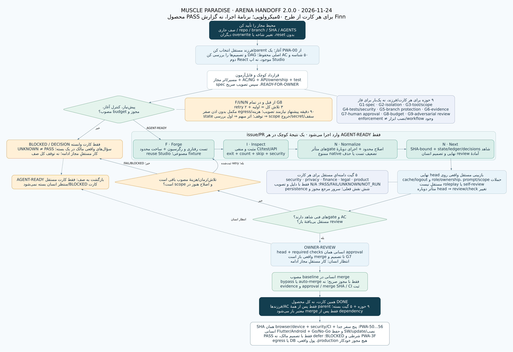
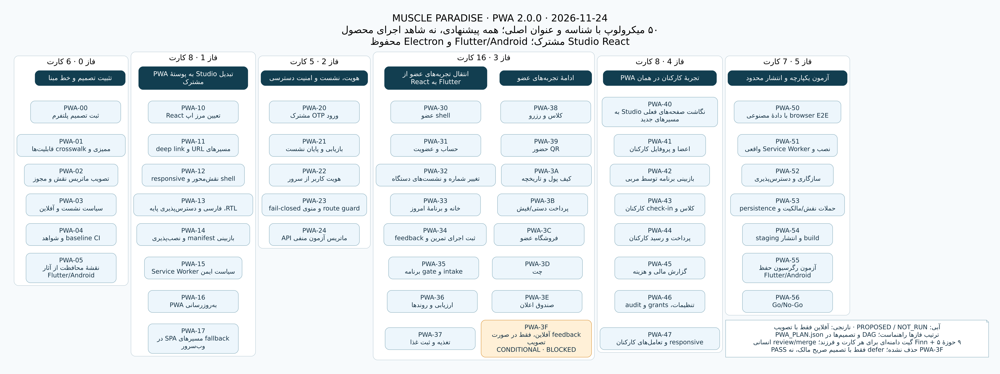

# تحویل کامل Arena — یک PWA مشترک React با حفظ Flutter/Android

**Muscle Paradise · نسخهٔ 2.0.0 · 2026-11-24 · برنامهٔ اجرا، نه گزارش آمادگی محصول**

> **از `PWA-00` شروع کن؛ اپ React دوم نساز.** پایهٔ کار `mp-app/studio/` است. صفحه‌های کارکنان حفظ و سازگار می‌شوند؛ رفتارهای عضو از Flutter تدریجی منتقل می‌شوند. ۵۰ parent با شناسه/عنوان/مرز پذیرش ارسالی حفظ شده‌اند؛ `PWA-56` شمارهٔ آخر است، نه تعداد کارت‌ها.

## ۱. پیام آماده برای بیلدر بدون سابقهٔ گفتگو

متن زیر را همراه **کل ZIP بازشده** به Arena بده؛ فایل zip یا نمودارِ تنها، جای دسترسی به قراردادها نیست:

```text
این بستهٔ v2.0.0 برنامهٔ PWA محصول Muscle Paradise است، نه گزارش PASS محصول.
ابتدا README_FIRST.fa.txt، HANDOFF.fa.md، SOURCE_PLAN.fa.md و FINN_LOOP_FINAL.fa.md را بخوان.
محصول در مخزن yousefghorbanian98-create/MP است؛ Chat2DB فقط میزبان این handoff است.
repo/شاخه/وضعیت/AGENTS و SESSION_HANDOFF جاریِ محیط خودت را بدون reset یا تعویض شاخه تأیید کن.
مرجعِ بررسی‌شدهٔ این بسته MP/c46e792657e361cd09799c896c47149b4a5c4d86 است، نه الزام به checkout آن.
PWA-00 را از inventory خواندنی، بررسی تصمیم React/Studio و آماده‌سازی ADR/قرارداد آغاز کن.
mp-app/studio/ را گسترش بده؛ اپ React دوم یا Flutter Web جایگزین نساز.
همهٔ ۵۰ شناسه، عنوان و مرز پذیرش SOURCE_PLAN حفظ شوند؛ فرزندهای کوچک با parent mapping بساز.
Flutter/Android، اسناد و jobهایشان و Electron را حذف/overwrite یا خاموش نکن.
فقط کار AGENT-READY با قرارداد صریح، بودجه، ۹ حوزهٔ Finn و پنج گیت دامنه‌ای را بساز.
تصمیم‌های برگشت‌پذیر در scope را ثبت کن؛ سؤال‌های واقعی مالک را در یک بسته جمع کن؛ فقط وابستگان BLOCKED بمانند.
UNKNOWN/NOT_RUN قبولی نیست؛ self-review را مستقل ننام؛ بدون human review/merge کارت DONE نیست.
این handoff مجوز MP push/merge/deploy/release/DB/پرداخت/egress یا API مدل بیرونی نیست.
اولین خروجی: هویت محیط و SHA، count دقیق ۵۰ کارت، شکاف‌ها/مصوبات معتبر، قرارداد کوچک PWA-00،
بستهٔ تصمیم‌های باقی‌مانده، دستورهای آزمون واقعی و فهرست کارهای مستقل قابل‌ادامه.
```

نسخهٔ قابل‌کپی همین مأموریت در [RESUME_PROMPT](templates/RESUME_PROMPT.fa.txt) است. انتخاب React روشن است؛ ADR و baseline انتشار باید در مخزن محصول ثبت و با محدودیت‌های جاری هم‌راستا شوند. هیچ approval دیگر از این انتخاب استنتاج نشود.

## ۲. کدام مخزن، کدام شاخه، کدام شواهد؟

| مورد | حقیقت قابل اتکا |
|---|---|
| محل تحویل | `yousefghorbanian98-create/Chat2DB`؛ شاخهٔ این تحویل `arena/d885a3c9-chat2db`؛ اینجا `mp-app/` وجود ندارد |
| محصول | `yousefghorbanian98-create/MP`؛ مرجع درخواستی کاربر `arena/5e0f64cf-mp` |
| pin منبع | `c46e792657e361cd09799c896c47149b4a5c4d86`، commit زمان `2026-11-24T08:58:07Z`؛ خواندن source/API متادیتا، نه اجرای محصول |
| شاخهٔ اجرا در آینده | فقط شاخه‌ای که محیط مقصد مجاز کرده است؛ شاخه‌های نوشته‌شده در اسناد مرجع تاریخی‌اند و دستور switch/create/push نیستند |
| طرح اصلی این نسخه | متن جدول ارسالی کاربر در [SOURCE_PLAN](SOURCE_PLAN.fa.md)؛ ۶/۸/۵/۱۶/۸/۷ کارت در شش فاز |
| نسخهٔ ۱ | ۲۸ مورد **پیشنهاد تازه** داشت، نه نگاشت تأییدشدهٔ طرح قبلی؛ تاریخی بماند و با v2 مخلوط نشود |
| مرز شاهد | تست ساخت ZIP، همگامی طرح، منبع‌خوانی و نمودار ≠ QA محصول، CI محصول، تست دستگاه، review مستقل یا Go |

**خطای تحویل قبلی اصلاح شده، نه توجیه:** مدرک شمارش ۵۶ ردیف قبلی یا تبدیل آن به ۲۸ وجود نداشت؛ عدد ۲۶ گزارش‌شدهٔ builder نیز هنوز توضیحِ اثبات‌شده ندارد. مرجع اجراییِ منتخب اکنون همین ۵۰ ردیف ارسالی است؛ نه شش کارت ساختگی اضافه شده و نه موردی به بهانهٔ consolidation حذف شده است. [گزارش مقایسه و تغییرات](COMPARISON_AND_CHANGELOG.fa.md) تصمیم را مستند می‌کند.

## ۳. هدف و مرز محصول

**خروجی هدف:** یک React PWA برای عضو و کادر با URLهای محافظت‌شده، RTL/فارسی، responsive و هویت مشترک؛ سرور مرجع نقش/مجوز/ownership و persistence است. Studio موجود، Ant Design، React/Vite/Zustand و طرح‌های فعلی تا جایی که نیازمند اصلاح واقعی نباشند بازاستفاده شوند. Electron محفوظ است ولی packaging دسکتاپ پیش‌شرط PWA نیست.

**محفوظ:** `mp-app/client/`، Android و فایل‌های native، تست‌ها، مستندات Flutter، workflowهای Flutter/Android و `web.yml` که در pin فعلی Flutter Web می‌سازد؛ این workflow نباید بی‌تصمیم بازنشسته یا بی‌صدا با React جایگزین شود. React از `mp-app/studio/` build می‌شود. shared tokenها با regression native تغییر کنند، نه overwrite.

**مجوز ضمنی ندارد:** تبدیل شش نقش به سه، تغییر grants/DB/tenant، انتقال کامل به cloud، خرید VPS/دامنه، تشخیص چهره، عکس پیشرفت بدن، ادعای پزشکی/تغذیه یا تولید عدد تمرین توسط LLM، gateway/checkout/پرداخت واقعی، production/deploy/rollback، egress کد/داده یا telemetry بیرونی. backend gap فقط با شاهد و میکرولوپ جدا اصلاح می‌شود.

**آفلاین پیشنهادی نسخهٔ اول:** online-first؛ cache فقط shell/دارایی ایستای allowlist و غیرشخصی. API، POST، نشست، receipt، chat، health و دادهٔ شخصی cache یا offline-write نشوند. PWA-3F فقط در صورت تصویب رمزنگاری/لغو/sync/تعارض/سقف/TTL، و در آغاز BLOCKED است. [رجیستر تصمیم](templates/DECISION_REGISTER.json) از بسته مجوز offline داده نمی‌گیرد.

## ۴. وضعیت فعلیِ دیده‌شده در source، نه ادعای اجرا

| مشاهده در pin مرجع | نتیجهٔ برنامه‌ای |
|---|---|
| Studio صفحه‌های کارکنان، React/Vite، manifest، icon و `sw.js` دارد | از صفر scaffold نشود؛ ممیزی و اصلاح gap واقعی |
| `App.tsx` عمدتاً با state صفحه انتخاب می‌کند | PWA-11 و PWA-40 URL/history/deep link و نگاشت صفحه لازم دارند |
| `AuthContext.tsx` allowlist پنج نقش staff دارد و member ندارد | ورود یکپارچه هنوز از وجود OTP مشترک نتیجه نمی‌شود؛ PWA-20/22/23 |
| `src/lib/session.ts` tokenها را در `localStorage` می‌گذارد و مرز XSS را هشدار می‌دهد | PWA-03/21 تصمیم security/storage و race/revoke می‌خواهند؛ storage امن یا مهاجرت cookie خودکار فرض نشود |
| manifest فعلی MP Studio/پنل مربی است | هویت PWA مشترک و start/scope/install در PWA-14 بررسی شود |
| SW `/api/` را کنار می‌گذارد، ولی activation/`skipWaiting`، cache وسیع و حذف cacheهای دیگر origin دارد | PWA-15/16؛ method/origin/path allowlist، عدم cache حساس و حفظ cache بی‌ربط لازم؛ صرف «API کنار گذاشته شده» کافی نیست |
| `pwa.test.ts` بررسی manifest/icon و source-text دارد | installation/offline/update واقعی و browser cache evidence هنوز لازم‌اند |
| `nginx.conf` SPA fallback و `/api/` proxy موجود دارد | PWA-17 رفتار direct/refresh/content-type را ثابت کند؛ پیکربندی موجود مساوی deployment تست‌شده نیست |
| کاتالوگ export فعلی ۱۴۱ قالب مسیر و ۱۶۳ operation دارد؛ ۱۷ حوزهٔ Flutter فهرست شده‌اند | ورودی crosswalk، نه اثبات server enforcement یا parity کامل |
| `ci.yml` backend/Studio/native/security و `web.yml` Flutter Web را تعریف می‌کنند | PWA-04 command/exit/required status تازه را در SHA اجرا ثبت کند؛ YAML مساوی gate enforced نیست |

منبع دقیق، hash و لینک pin در [references/README](references/README.fa.md)، [SOURCE_MANIFEST](references/SOURCE_MANIFEST.json)، [MP_SOURCE_INVENTORY](references/MP_SOURCE_INVENTORY.json) و snapshotهای صرفاً متنی داخل ZIP آمده است. snapshot دستور اجرایی یا AGENTS حاکم بر این مخزن تحویل نیست.

## ۵. شروع قدم‌به‌قدم از PWA-00

### گام ۱ — بسته را سالم و جدا از runtime نگه دار

فایل `.zip.sha256` بیرون ZIP، خود ZIP را کنترل می‌کند. پس از استخراج، از ریشهٔ همان پوشه:

```bash
sha256sum -c MANIFEST.sha256
python3 scripts/sync_plan.py --check
python3 scripts/validate_package.py
```

همهٔ این‌ها فقط بسته را می‌سنجند و محصول/شبکه/نصب را اجرا نمی‌کنند. Python 3.11+ لازم است. HTML آفلاین `HANDOFF.fa.html` هیچ JS/tracker/font شبکه‌ای ندارد و نمودارها و همهٔ ۵۰ کارت را در خود دارد.

### گام ۲ — محیط مقصد را بدون حدس تأیید کن

متغیرهای زیر **نمونه‌اند**؛ بعد از انتخاب checkout و شاخهٔ مجاز واقعی مقدار بده. `MP_REPO` نباید Chat2DB یا صرفاً پوشهٔ snapshot باشد.

```bash
HANDOFF=/absolute/path/MP-PWA-Arena-Handoff-v2.0.0
MP_REPO=/absolute/path/to/authorized/MP
cd "$MP_REPO"
git status --short --branch
git rev-parse --show-toplevel
git rev-parse HEAD
git branch --show-current
python3 "$HANDOFF/scripts/preflight.py" --repo "$MP_REPO"
```

preflight فقط دو manifest allowlist و layout و metadata محلی Git را می‌خواند؛ هیچ source، hook، install، network، DB، API یا تست محصول اجرا نمی‌کند. خروجی موفق فقط `INVENTORY_OK_NOT_QA` است و هرگز AGENT-READY نیست. خروجی روی Chat2DB عمداً `BLOCKED`/exit 2 است. pin متفاوت در checkout جدید یعنی reconcile با کد فعلی؛ نه دستور reset/checkout قدیمی.

### گام ۳ — مراجع فعال مقصد را بخوان و قرارداد کوچک بده

`AGENTS.md` و scoped AGENTS، `docs/MuscleParadise/SESSION_HANDOFF.md`، صف فعلی، ADR، `OWNER-DECISIONS.md`، `FINN_LOOP.md` با هشدار تاریخی/ECC و workflowهای مرتبط را بررسی کن. گزارش قدیمی فقط lead است؛ اجرای تازه نیست. وضعیت dirty مانع پاک‌سازی تغییرات دیگران نیست: untouched بمانند و patch/baseline تفکیک شود.

خروجی نخست PWA-00: ADR پیشنهادی جهت React/Studio و native preservation، baseline release باز، allowlist مسیر/فرمان، فهرست آثار محفوظ PWA-05، قرارداد AC/NG کوچک، تصمیم‌های واقعاً باز و budget/reviewer. نوشتن قرارداد با اجرای محصول یا تصویب آن یکی نیست. فقط کارتِ صریحاً AGENT-READY وارد Forge شود؛ ادامهٔ کار مستقل با قرارداد معتبر نیاز به سؤال روتین ندارد.

### گام ۴ — inventory و evidence قبل از تغییر محصول

PWA-01/04/05 می‌توانند read-only و مستقل پیش بروند. [FEATURE_PARITY](templates/FEATURE_PARITY.csv) ۱۷ حوزه را با source path و parent PWA شروع کرده؛ API/test/ownership عمداً UNKNOWN است تا از source واقعی تکمیل شود. [INTERACTION_MATRIX](templates/INTERACTION_MATRIX.csv) هر کنترل را به event→API→اثر سرور→UI states→مثبت/منفی/evidence متصل می‌کند. «دکمه کار می‌کند» بدون اثر معتبر سرور پذیرش نیست.

### گام ۵ — ابزار فقط به‌اندازهٔ نیاز کارت

[TOOLCHAIN.fa.md](TOOLCHAIN.fa.md) منبع، نسخه/مجوز، نصب ایزوله، روش استفاده و وضعیت آزموده‌شدن ابزارها را دارد. ابتدا Finn/CI/Semgrep/Gitleaks و testهای موجود؛ ابزار ترسیم خارج dependency محصول نصب می‌شود. هیچ install-all، ECC، orchestrator موازی یا مدل ابریِ اجباری در کار نیست.

## ۶. نقشهٔ شش فاز و زنجیرهٔ پذیرش

| فاز | تعداد | شناسه‌های دقیق | نتیجهٔ هدف، نه شاهد انجام |
|---|---:|---|---|
| ۰ | ۶ | PWA-00…PWA-05 | تصمیم UI/ADR، crosswalk، role/session/offline decision، baseline و محافظت native |
| ۱ | ۸ | PWA-10…PWA-17 | Studio مشترک، URL/shell/RTL، manifest/SW/update و SPA fallback |
| ۲ | ۵ | PWA-20…PWA-24 | OTP/session/هویت سرور، fail-closed و ماتریس منفی API |
| ۳ | ۱۶ | PWA-30…PWA-39، PWA-3A…PWA-3F | رفتار عضو، ownership/persistence و آفلاین شرطی |
| ۴ | ۸ | PWA-40…PWA-47 | تطبیق صفحات کارکنان، برنامه/حضور/رسید/مالی/grants و responsive |
| ۵ | ۷ | PWA-50…PWA-56 | browser/device/PWA/security/staging/native و Go/No-Go انسانی |

**مرجع کامل هر ۵۰ عنوان و AC:** [MICROLOOPS.fa.md](MICROLOOPS.fa.md). در HTML آفلاین، همین فهرست کامل در ادامهٔ صفحه هم تعبیه شده است. [PWA_PLAN.json](PWA_PLAN.json) همان فهرست را با dependency، D IDs، source paths، ۹+۵ gate و budget در **هر رکورد** نگه می‌دارد. [TASK_TRACEABILITY.csv](TASK_TRACEABILITY.csv) نگاشت ۱:۱ source→plan→heading→diagram دارد. `PLAN_IDENTITY.json` و تست‌های مستقل از output، count و noncontiguous IDs را کنترل می‌کنند.



تصویر بالا چرخهٔ هر کارت، توقفِ فقط وابسته، budget و review/merge انسانی را نشان می‌دهد. [راهنمای نمودار](diagrams/PWA_Finn_Loop_Flow.fa.md) و SVG قابل بزرگ‌نمایی داخل ZIP هستند.



این نقشه **همهٔ شناسه‌ها را جداگانه** نمایش می‌دهد؛ یال فازها خوانایی کلی است، نه الزام اجرای serial همهٔ کارت‌ها. dependency دقیقِ پیشنهادی در JSON است. کارت PWA-3F مشخصاً conditional/BLOCKED باقی است.

## ۷. Finn و کم‌وقفه‌بودن، بدون حذف انسان

قرارداد کامل در [FINN_LOOP_FINAL.fa.md](FINN_LOOP_FINAL.fa.md): Forge → Inspect → Normalize → Next، یک outcome کوچک، ۹ حوزهٔ مستقل برای هر کارت/فرزند و پنج gate مستقل security/privacy/finance/legal/product. کنترل محیط، branch protection، evidence SHA-bound، budget و review خصمانه/مستقل باید واقعاً برقرار باشند؛ وجود workflow یا نصب ابزار برابر enforcement نیست.

سه تلاش **کل** یعنی اولیه + دو retry؛ این عدد با G4 متن Finn مرجع سازگار است، ولی runtime enforced ادعا نشده است. **۹۰ دقیقه پیشنهاد این بسته و نیازمند تصویب مالک** است، نه عدد قطعی قبلی؛ تماس پولی/egress مکمل بدون مجوز صفر. اجرای بعدی بدون سقف عددی مصوب AGENT-READY نیست. در مرز ایمنی/هزینه/مالکیت توقف زودتر لازم است. تضعیف تست، skip/ignore، reset/clean یا بازشماره‌گذاری برای صفرکردن budget ممنوع.

تصمیم کوچک برگشت‌پذیرِ داخل scope را ثبت کن؛ سؤال واقعی را batch کن و فقط dependency مربوط را block کن. قرارداد انسان قبل از build، reviewer مستقل واقعی روی head نهایی، گیت‌ها و تصمیم merge انسانی لازم‌اند؛ نه approval روتین برای هر فرمان و نه auto-merge. هر تغییر پس از review، گیت و review اثرگرفته را دوباره لازم می‌کند.

## ۸. تصمیم‌های مالک و خطرهای وابسته

D-01…D-11 **واقعاً از جدول source خطوط 68–78 بازیابی شده‌اند**؛ دیگر reserved/unmapped نیستند. [DECISION_PACKAGE](DECISION_PACKAGE.fa.md) سؤال‌ها را با گزینهٔ پیشنهادی و کار مستقل جمع می‌کند. `DECISION` در رجیستر یعنی هنوز owner input لازم است، نه انتخاب نهایی. پاسخ‌های قبلی معتبرِ محصول در checkout جدید باید reconcile شوند؛ ثبت Dهای پیش‌نویس، تصمیم‌های قبلی را باطل نمی‌کند.

چهار محور فوری: baseline انتشار با حفظ native؛ شش نقش فعلی در برابر target سه‌نقشیِ صرفاً پیشنهادی؛ session storage و XSS/refresh/revoke؛ online-first و staging/release contract. دیگر Dها فقط در صورت اثر واقعی فعال شوند؛ DB/tenant/model/health خارج AC با حدس تغییر نکنند. PWA-3F در release بدون آفلاین فقط با **defer صریح مالک و ثبت scope** از مسیر critical خارج می‌شود؛ BLOCKED یا defer را PASS ننویس.

## ۹. پنج سفر نهایی که نباید با هم ادغام شوند

1. **عضو:** OTP → پروفایل خودش → برنامهٔ سرورِ تأییدشده → ثبت واقعی execution/feedback → reload و مشاهدهٔ persistence همان نسخه.
2. **مربی:** ورود → عضو مجاز → assessment → draft → approve/reject با دلیل و نسخه → مشاهدهٔ **همان نسخه** برای عضو. LLM تصمیم‌گیرندهٔ بار/ست/تکرار نیست.
3. **حضور:** عضو/پذیرش → QR → validation سرور → رد انقضا/replay/عضو دیگر/duplicate؛ local QR مجوز ورود نیست و قفل دستگاه یا بیومتریک خودکار ادعا نشود.
4. **مالی:** عضو receipt خصوصی ارسال کند → کارمند دارای grant بازبینی انسانی مستقل کند → نتیجه/actor/audit ثبت؛ submit موفق با تأیید بانک یا فعال‌سازی خودکار یکی نیست. هیچ پول واقعی در تست نیست.
5. **امنیت:** عضو A نتواند route/API/receipt/message/health/wallet یا دادهٔ عضو B را ببیند؛ دست‌کاری URL و token/role مرورگر، revoked grant، stale session و cache-after-logout هم بررسی شوند.

PWA-56 فقط روی **یک SHA نهایی** با feature crosswalk، browser installation/update، تست API/ownership، accessibility/device، security review، CI و native gates تصمیم می‌گیرد. mock-only، emulation-only، catalog metadata یا «همهٔ صفحه‌ها ساخته شد» Go نیست. UNKNOWN در جریان اصلی مانع اعلام تکمیل است. staging و production و rollback مجوزهای متفاوت دارند؛ PWA-54 مجوز deploy خودکار نمی‌دهد.

## ۱۰. فایل‌ها و روش استفاده

| فایل/پوشه | نقش |
|---|---|
| README_FIRST.fa.txt / HANDOFF.fa.html | شروع سریع و خواندن مستقل آفلاین با کل کارت‌ها و نمودارها |
| SOURCE_PLAN.fa.md / PLAN_IDENTITY.json | متن جدول‌های کاربر، شمارش واقعی و مرجع ضدحذف/بازشماره‌گذاری |
| MICROLOOPS.fa.md / PWA_PLAN.json / PLAN_DETAILS.json | ۵۰ کارت؛ اولی متن انسان، دومی ماشین‌خوان، سومی enrichment پیشنهادی قابل بازبینی |
| FINN_LOOP_FINAL.fa.md | قرارداد هر میکرولوپ/فرزند، ۹+۵ gate، budget/stop و انسان |
| COMPARISON_AND_CHANGELOG.fa.md | چرا طرح جدید بهتر است، اصلاح خطاها و اثر تغییر در همهٔ artifactها |
| DECISION_PACKAGE.fa.md / templates/DECISION_REGISTER.json | تصمیم‌های واقعی D-01…11 و پاسخ‌های باز، بدون جعل approval |
| TOOLCHAIN.fa.md / tooling/ / config/ | منبع/مجوز/نصب/کاربرد ابزار، lock جدا و مثال غیرمدعیِ کامل‌بودن |
| templates/ | قرارداد، ADR، evidence، interaction/parity، دفترچهٔ state و prompt انتقال |
| scripts/ | inventory خواندنی، sync/check دقیق source، اعتبارسنجی hash و renderer مستندات؛ نه orchestrator جدید |
| diagrams/ | دو PNG/SVG و DOT/Mermaid متن‌باز قابل‌ویرایش + شرح وضعیت/legend |
| references/ | snapshot متنی محدود با pin/hash، API metadata و catalog ابزار؛ نه runtime کامل محصول |
| VERIFICATION.fa.md / PACKAGE_MANIFEST.json / MANIFEST.sha256 | چه چیز واقعاً برای این تحویل اجرا شده، چه نشده، و کنترل تمامیت بسته |

**این ZIP شامل SDK، browser binary، node_modules، DB، `.env`، secret، دادهٔ عضو یا APK نیست.** نصب و اجرای محصول در اختیار محیط مجاز MP و قرارداد همان کارت است. بازتولید ZIP و تست تحویل از مخزن تحویل در `handoff/README.md` آمده است؛ ابزارهای ساخت تحویل dependency محصول نیستند.
