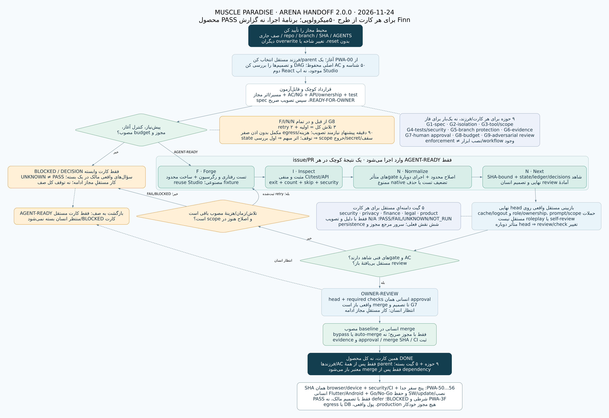
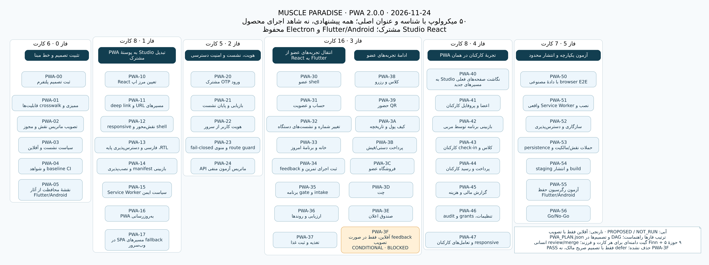

# نمودارهای اصلاح‌شدهٔ برنامهٔ PWA / Finn — v2.0.0

**وضعیت هر دو نمودار:** طرح اجرا/هدف؛ هیچ node یا پیکان گواه اجرای محصول یا PASS نیست. ref منبع MP در `c46e792657e361cd09799c896c47149b4a5c4d86` و طرح منتخب همان ۵۰ ردیف پیام کاربر است. انتخاب React به معنی role/DB/offline/payment/release approval نیست.

## ۱. چرخهٔ هر کارت و فرزند

[SVG قابل بزرگ‌نمایی](PWA_Finn_Loop_Flow.fa.svg) · [DOT منبع تصویر](PWA_Finn_Loop_Flow.fa.dot) · [Mermaid هم‌معنا](PWA_Finn_Loop_Flow.fa.mmd)

- از PWA-00 و inventory/قرارداد آغاز؛ Studio موجود یک PWA عضو/کادر می‌شود؛ Flutter/Android، jobها و Electron محفوظ.
- spec approval و کنترل‌های آغاز، AGENT-READY می‌سازند؛ نه وجود این نمودار یا سبزبودن کار قبلی.
- Forge → Inspect → Normalize → Next؛ نه حوزهٔ Finn و پنج گیت مستقل برای **هر کارت/فرزند**؛ evidence همان head، reviewer واقعاً مستقل و merge انسانی.
- گیت‌های فنی پیش از OWNER-REVIEW شواهد می‌خواهند؛ G7 تا approval/merge انسانی بسته نیست. تغییر head review/check متأثر را دوباره لازم می‌کند.
- نارنجی یعنی تصمیم/وقفه/سقف: فقط وابسته BLOCKED؛ کار مستقلِ مجاز ادامه. سه تلاش **کل**، دو retry؛ ۹۰ دقیقه پیشنهاد نیازمند تصویب؛ پول/egress مکمل بدون اذن صفر.
- `UNKNOWN/NOT_RUN` قبولی نیست؛ branch protection/workflow/نصب ابزار باید واقعاً بررسی شوند. در سقف/secret/خروج scope توقف، نه skip/ignore/reset/clean.
- PWA-50…56 مرور پنج سفر، نصب واقعی/SW/update، دستگاه/دسترس‌پذیری، API attacks، CI/native و Go/No-Go انسانی را جدا نگه می‌دارد. هیچ production/deploy/live money خودکار نیست.

جزئیات normative در [FINN_LOOP_FINAL.fa.md](../FINN_LOOP_FINAL.fa.md) است؛ نمودار خلاصه است و قرارداد متن را حذف نمی‌کند.

## ۲. نقشهٔ کامل ۵۰ parent در شش فاز

[SVG قابل بزرگ‌نمایی](PWA_50_Microloops.fa.svg) · [DOT](PWA_50_Microloops.fa.dot) · [Mermaid](PWA_50_Microloops.fa.mmd)

- ۶ + ۸ + ۵ + ۱۶ + ۸ + ۷ = **۵۰**. PWA-56 آخرین شناسه است، نه تعداد. همهٔ PWA-3A…3F حضور دارند.
- آبی/سفید = PROPOSED/NOT_RUN، نه CURRENT یا PASS. نارنجیِ PWA-3F = CONDITIONAL/BLOCKED؛ defer فقط با تصمیم صریح مالک و ثبت scope، نه PASS.
- فاز ۳ برای خوانایی در دو ستون ادامه یافته است؛ هر دو یک فاز با ۱۶ parent هستند. ترتیب بصری فازها راهنماست، نه serialization همهٔ کارها؛ DAG پیشنهادی و D blockers در JSON هستند.
- ID و عنوان هر node از SOURCE_PLAN تولید می‌شود. [MICROLOOPS](../MICROLOOPS.fa.md) و [PWA_PLAN](../PWA_PLAN.json) ACهای کامل را نگه می‌دارند؛ نمودار جای معیار پذیرش نیست.

## بازتولید

راهنمای نصب renderer جدا در [TOOLCHAIN](../TOOLCHAIN.fa.md) است. متن DOT نقشه با `python3 scripts/make_roadmap.py` تولید می‌شود؛ `--check` خواندنی است. PNG/SVG از DOT با Viz/Sharp pin‌شده تولید شده‌اند؛ Mermaid در این تحویل رندر نشده و ادعای browser/product test از رندر اسناد نتیجه نمی‌شود. فونت مجازِ فارسی در محیط renderer لازم است؛ font/binary در ZIP نیست.
